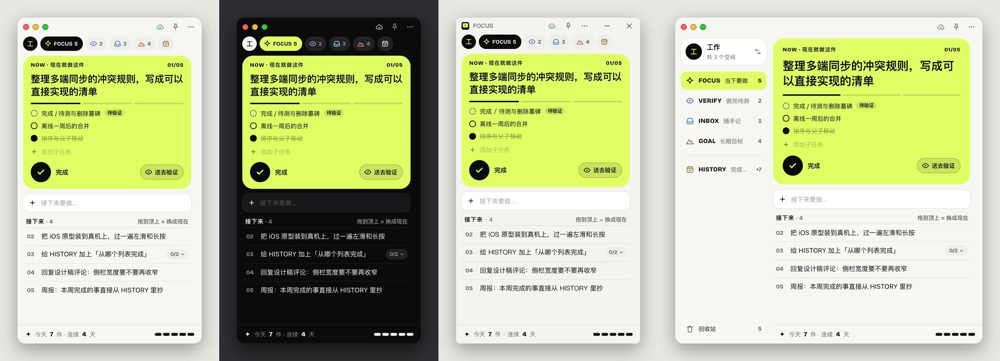

# FOCUS

一次只做一件事的 TODO 小窗，桌面版 Windows / macOS 通用，另有 iOS 版。



四个列表加一个完成记录：

| 分区 | 用途 |
| --- | --- |
| **FOCUS** | 当下要做。排第一的那件是荧光绿的 **NOW 卡**，其余排在「接下来」 |
| **VERIFY** | 做完待测：做完了但还要再看一眼，测完才算结束 |
| **INBOX** | 随手记：想到什么先丢进来 |
| **GOAL** | 长期目标：给自己的提醒，不显示进度 |
| **HISTORY** | 完成记录：今天 / 本周 / 连续天数、热力图、按天分组 |

典型流程：INBOX →（星芒钮）→ FOCUS 的「接下来」→ 设为现在 → 做完勾掉，或「送去验证」→ VERIFY → 测完勾掉 → INBOX 的已完成。

## 功能（桌面版）

界面按设计交接包 [design_handoff_focus/](design_handoff_focus/README.md)（F「一件事」）实现，各画面截图见 [docs/desktop/](docs/desktop/README.md)。

- **布局**：窗口默认 384×680，最小宽 320
  - 宽 < 520（compact）：标题栏下一排页签胶囊：空间头像 + FOCUS / VERIFY / INBOX / GOAL / HISTORY，选中项展开显示名字
  - 宽 ≥ 520（regular）：左侧 200 宽的侧栏：空间卡片、四个列表（图标 + 英文名 + 中文副标 + 数字）、HISTORY（今天完成数）、底部回收站
  - 拉宽 / 收窄时两种布局平滑切换
  - 列表上的数字是**未完成的顶层项**数，和 NOW 卡上的 `01/05`、「接下来 · 4」一致
- **FOCUS 页**：NOW 卡 → 新建框 → 接下来 → 底部「今天 N 件 · 连续 N 天」
  - **NOW = FOCUS 里手动顺序排第一的未完成顶层项**（不加新字段）。卡上有子任务进度（每个子项一段）、最多 3 条子任务（未完成在前，多的写「还有 N 条」）、黑色完成钮、「送去验证」；双击标题编辑，右键看更多
  - **接下来**：序号 02、03…，越往后越淡。悬停时行变成白卡，左边出现拖拽点，序号换成勾选圈（可直接完成），右边出现「设为现在 ↑ / 送去验证 / ⋯」；有子任务的行右边是 `0/2` 胶囊，点开才展开子任务
  - **设为现在**：悬停按钮、右键菜单，或把一行**拖到 NOW 卡上**
  - **新建**：回车新建，排在 NOW 之后，不抢正在做的那件；`⌘/Ctrl + 回车` = 新建并设为现在。输入框保持焦点，可以连续输入
  - FOCUS 空了显示「Nothing now.」，可以去 INBOX 挑一件或写一件
- **VERIFY / INBOX / GOAL**：列表头 + 新建框 + 行
  - VERIFY 顶层项右侧的星芒钮 = **退回 FOCUS**；勾选 = 测完了，进 INBOX 的已完成
  - INBOX 顶层未完成项右侧的星芒钮 = **送进 FOCUS**（排在 NOW 之后）；已完成折叠在「已完成 · N」下
  - GOAL 每条一张卡：勾选圈 + 标题 + 「写下于 X 月 X 日」，**不显示任何进度**；有子项也只给一个折叠箭头
- **完成**：FOCUS / VERIFY 的顶层项完成后自动移到 INBOX 的已完成；子项完成留在父项下；完成父项时子孙一并完成
- **送去验证**：顶层项整棵进 VERIFY 并恢复未完成；子项原地挂「待验证」（虚线圈），点标签取消
- **子任务**：按创建顺序排（新建的在最后）。悬停点 `+` 或右键「添加子任务」会在子项最后开一个空行；可无限嵌套，用缩进 + 竖线显示层级
- **像大纲一样编辑**（双击文字进入；桌面和 iOS 同一套规则，`⋯` 菜单「快捷键与编辑…」里也有）：
  - `Enter`：保存，并在后面开一个同层级的空行；空行有内容再回车才新建，接着再开下一行；空行上直接回车就结束
  - `Tab` / `Shift+Tab`：缩进（挂到上一条下面，成为它的最后一个子项）/ 反缩进（升一级，排在原父项后面）。正在编辑的条目和空行都可以，编辑框不关、没保存的字不丢；同级第一个按 Tab、顶层按 Shift+Tab 不动，编辑框抖一下
  - `⌥⇧↑` / `⌥⇧↓`（Windows：`Alt+Shift+↑/↓`）：在同级里上移 / 下移
  - `↑` / `↓`：光标在开头 / 结尾时，跳到上一条 / 下一条继续编辑
  - `Backspace`：空行上关掉空行，回到上一条；`Esc`：放弃这次修改 / 关掉空行；点到别处时空行里有字就留下
  - 拼音组字时这些键只上屏，不触发
- **NOW 卡上的子任务**：默认全部显示（整棵子树，缩进表示层级），太多时可以收起；底部常驻「+ 添加子任务」，回车添加后不关，可以连续加；悬停出现「待验证」开关（眼睛）和删除；右键是精简菜单：完成、编辑、待验证 / 取消待验证、升一级、删除
- **移动**：右键「移到 ›」（子项可以提升为顶层项），或把行拖到页签胶囊 / 侧栏上；同层同状态内拖拽排序
- **HISTORY**：今天（荧光绿）/ 本周 / 连续天数三格、最近 16 周热力图（窗口宽时多显示几周，点一天跳到那天）、按天分组（时间 + 列表色圆点 + 标题，第二行写「在 VERIFY 完成 · 含 2 个子项」或「父项 › 子项」）；悬停可「恢复为未完成」
- **菜单**
  - 标题栏 `⋯`：回收站（数量）、同步设置（右侧显示状态）| 外观 ›、完成提示音（开关）、打开数据文件夹 | 快捷键与编辑…、版本
  - 右键 / 行上的 `⋯`：完成、编辑、添加子任务 | 设为现在、送去验证、移到 › | 删除（`⌫`）
  - Profile 菜单（页签行头像 / 侧栏空间卡片，或 `⌘/Ctrl + Shift + P`）：数字键切换，悬停一项可改名 / 删除，底部新建
- **回收站**：从 `⋯` 菜单或侧栏底部进入。删除的条目连同子项保留 30 天，「恢复」回到原来的位置；「彻底删除」和「清空」都要再点一次
- **删除后 5 秒内可撤销**：底部黑色提示条，左边圆环倒计时，右边荧光绿「撤销」（或 `⌘/Ctrl + Z`）
- **动效**：完成 NOW 是「换场」（卡片被抽走，下一件变形成新的 NOW 卡）；普通行完成迸出 6 颗星芒，一颗飞向 HISTORY，图标弹一下冒 +1；送去验证时眼睛眨一下、行缩小飞向 VERIFY；设为现在两张卡交换；新建的行撑开并荧光绿闪一下；切换列表交叉淡入。系统开了「减少动态效果」时全部换成 150ms 交叉淡入
- **外观**：`⋯` 菜单「外观」选跟随系统（默认）/ 浅色 / 深色，立即生效，窗口外框和系统控件也跟着变；只存在本机（`focus-local.json`），不同步。NOW 卡在两种主题下都是荧光绿
- **标题栏**：macOS 是系统红绿灯（12, 14）+ 右侧云朵、图钉、`⋯`；Windows 是无边框 36 高标题栏：左边应用图标 + FOCUS，右边云朵、图钉、`⋯`，再接最小化 / 关闭（关闭悬停红色 #C42B1C），底色比 Mac 冷一点
- 窗口可置顶（标题栏图钉），位置、大小、置顶状态自动记住
- 字体：英文标签、列表名和数字用 Bricolage Grotesque（OFL，随应用打包，`@fontsource/bricolage-grotesque`）；中文和正文用系统字（苹方 / 微软雅黑 UI）

### 多端同步（坚果云 WebDAV）

桌面版和 iOS 版都直接通过坚果云 WebDAV 同步，不需要开着坚果云客户端。

- 设置：桌面 `⋯` 菜单 →「同步设置」，iOS `⋯` 菜单 →「同步」。填坚果云账号和**应用密码**（坚果云网页「账户信息 → 安全选项 → 第三方应用管理」生成），同步文件夹默认 `FOCUS`，不存在会自动创建。密码只加密存在本机钥匙串里
- 时机：打开时同步；增删改后约 2 秒上传；在线时每 15 秒检查远端，有新改动就自动拉下来合并；窗口获得焦点、App 回到前台、网络恢复、电脑唤醒时立即检查；退出、睡眠、切到后台前先把改动传完
- 离线：改动照常存在本机，联网后自动补传；坚果云限流时自动退避重试
- 合并：每条待办按"标题 / 完成状态 / 位置 / 排序 / 删除"分开合并，两边改的不是同一处就都保留；同一处的改动自动取后改的那个
- 需要你决定的冲突（发现时自动弹出，也可以点标题栏的云朵图标打开）：
  - 同一条的标题被两台设备同时改成了不同内容：选一个，或都保留
  - 一边删除了、另一边同时改过（或在它下面加了子项）：恢复，或保持删除
  - 一边删除了整个 profile、另一边同时在里面改过：恢复，或确认删除
  - 在任何一台设备上做了决定，其它设备上的同一个冲突会自动消失
- 第一次在已有数据的设备上开启同步时，可以选「合并本机数据」或「以云端为准（本机先备份）」；本机只有上手示例时直接以云端为准
- 状态：标题栏的云朵图标有六种：已同步（绿色带勾）、同步中（双箭头旋转）、离线（灰色斜线）、出错（红色感叹号）、有冲突（红色数字角标）、未开启（虚线），见 [docs/desktop/mac-sync-states.jpg](docs/desktop/mac-sync-states.jpg)；同步设置里能看到各设备最后更新时间

设计与测试细节见 [docs/sync.md](docs/sync.md)。

### 让 AI agent 操作（MCP）

Claude Code、Claude 桌面版等 MCP 客户端可以直接读写 FOCUS：一次拿全量（各 profile、四个列表、子任务、待测、HISTORY、回收站），一次调用批量改多处。

- 先 `npm run build:agent`，再接入：

  ```bash
  claude mcp add --scope user focus -- node /path/to/FOCUS/dist-agent/focus-mcp.mjs
  ```

  Claude 桌面版的配置写法见 [docs/agent-api.md](docs/agent-api.md#6-接入)。
- 三个工具：`focus_read`（读，可按 profile / 分区 / 关键字过滤，或只拿某个 cursor 之后的变化）、`focus_apply`（批量写，整批原子：新增、改名、完成、移动、标待测、排序、删除恢复、profile 管理、处理冲突）、`focus_purge`（彻底删除，不可撤销）
- 桌面开着时，改动经本机接口（只监听 127.0.0.1，令牌鉴权）交给桌面执行，界面立刻刷新，约 2 秒后同步，底部弹出提示条「AI：新增 2 · 完成 1」
- 桌面没开时，改动先存在数据目录的 `agent/outbox.json`，桌面下次启动时并入并同步
- agent 拿不到坚果云密码；所有写入都和界面操作一样经同步时钟打戳，多端合并和冲突规则不变
- 不想开本机接口时，用环境变量 `FOCUS_AGENT=off` 启动桌面版

设计、工具说明和测试见 [docs/agent-api.md](docs/agent-api.md)。

### 快捷键

| 按键 | 作用 |
| --- | --- |
| `Ctrl/⌘ + 1 / 2 / 3 / 4 / 5` | 切换 FOCUS / VERIFY / INBOX / GOAL / HISTORY |
| `Ctrl/⌘ + Shift + P` | 打开 profile 菜单；菜单里按数字键切换 |
| `Ctrl/⌘ + N` | 聚焦新建框（在 HISTORY / 回收站时先回到 FOCUS） |
| `Enter` | 新建框里：新建（FOCUS 里排在 NOW 之后）；编辑时：保存并开下一行（见上面「像大纲一样编辑」） |
| `Ctrl/⌘ + Enter` | 在 FOCUS 新建并设为现在 |
| `Tab` / `Shift + Tab` | 编辑时缩进 / 反缩进 |
| `⌥⇧↑ / ↓`（Windows：`Alt + Shift + ↑ / ↓`） | 编辑时在同级里上移 / 下移 |
| `↑` / `↓` | 编辑时光标在开头 / 结尾：跳到上一条 / 下一条 |
| `Esc` | 放弃编辑、关掉空行、关闭菜单 / 面板 / 回收站，拖拽中取消拖拽 |
| `⌫` / `Delete`（右键菜单打开时） | 删除这一条 |
| `Ctrl/⌘ + Z` | 撤销刚才的删除 |
| `⌘ + W`（macOS） | 关闭窗口（应用留在 Dock，点图标重新打开） |

## 数据存放

数据是本地 JSON 文件（每次改动约 0.25 秒后原子写入，关窗前同步落盘），放在：

- Windows：`%APPDATA%\FOCUS\`
- macOS：`~/Library/Application Support/FOCUS/`

| 文件 | 内容 |
| --- | --- |
| `focus-doc.json` | 所有 profile 的数据（可同步的文档：每条待办带合并用的时间戳，删除的条目留在里面当回收站和墓碑） |
| `focus-local.json` | 只属于本机的状态：当前 profile、界面偏好、折叠状态、提示音、外观、同步进度 |
| `sync-config.json` | 同步设置（服务器、账号、文件夹、本机名称），不含密码 |
| `sync-secret.bin` / `device-id.bin` | 用系统钥匙串加密的应用密码 / 设备身份 |
| `focus-doc.backup-*.json` | 选「以云端为准」时本机数据的备份 |
| `agent-endpoint.json` | 桌面运行时给 AI agent 用的本机接口端口和令牌（只有本人可读，退出时删除） |
| `agent/` | 桌面没开时 AI agent 写下的改动（`outbox.json`）和 agent 的身份、时钟 |

每次读入时会把能正常读取的文件备份为同名的 `*.bak.json`；主文件损坏时自动用备份恢复。
从旧版本升级时，原来的 `profiles.json` / `focus-data.json` / `profiles/*.json` 会自动迁移进 `focus-doc.json`，旧文件原样保留作备份。
`⋯` 菜单里的「打开数据文件夹」可直接打开该目录。设置环境变量 `FOCUS_USER_DATA` 可改用其它目录。

## 开发

需要 Node.js 22.12+。

```bash
npm install
npm run dev        # Vite 开发服务器 + Electron 窗口，改代码热更新
npm run dev:web    # 只在浏览器里跑界面（数据存 localStorage），方便调样式
npm test           # 数据逻辑单元测试
npm run build      # 类型检查 + 打包前端 + 打包 MCP
npm run build:agent # 只打包 MCP：dist-agent/focus-mcp.mjs
npm start          # 构建后用 Electron 运行
npm run dev:webdav # 本机 WebDAV 测试服务器（http://127.0.0.1:8765/dav/，测试账号 focus-dev / focus-dev-pass），联调同步用
```

开发时可用的环境变量（都只影响本次启动）：

| 变量 | 作用 |
| --- | --- |
| `FOCUS_USER_DATA=<目录>` | 换一个数据目录。联调、截图时一律用临时目录，不要碰真实数据 |
| `FOCUS_FORCE_PLATFORM=win` | 在 Mac 上按 Windows 画界面：无边框窗口 + Windows 标题栏和配色（菜单、退出行为仍按真实系统），用来截图检查 |
| `FOCUS_FORCE_THEME=light` / `dark` | 固定浅色 / 深色，不跟随系统 |

浏览器调试（`npm run dev:web`）时可以在地址后面加 `?os=win` 看 Windows 标题栏。开发模式下控制台里有 `window.__focus`（store、带动效的操作、同步操作），打包后不含。

iOS 版见 [docs/ios.md](docs/ios.md)。联调同步时可以用 `VITE_FOCUS_E2E=1 npm run ios:build` 构建带测试遥控的 iOS 测试包（正式构建不含这段代码），详见 [docs/sync.md](docs/sync.md)。

## 打包

```bash
npm run dist:win        # 在 Windows 上：生成安装包和免安装版 exe
npm run dist:win:cross  # 在 Mac 上打 Windows 包（下载 Windows 版 Electron，x64）
npm run dist:mac        # 在 macOS 上：生成 dmg 和 zip
```

产物在 `release/` 目录。macOS 包需要在 Mac 上构建；未签名的 Mac 应用首次打开需要右键「打开」。
`dist:win` 用的是本机 `node_modules/electron/dist`，只能在 Windows 上跑；在 Mac 上要用 `dist:win:cross`（2026-10-18 实测能生成 NSIS 安装包和免安装版，未签名）。
应用图标由 `npm run icon` 从 `scripts/make-icon.cjs` 里的 SVG（取自 `design_handoff_focus/icons/app-icon-macos.svg` / `app-icon-windows.svg`）生成 `build/icon.icns`（Mac）、`icon.ico`（Windows）、`icon.png`（Linux）。

## 结构

```
electron/main.cjs      主进程：窗口、文件读写、IPC
electron/preload.cjs   向页面暴露 window.focusApi
src/model.ts           纯数据操作（排序、移动、完成、子树…），有单元测试
src/trash.ts           旧版回收站格式（迁移时读取）
src/sync/              多端同步：时钟、可同步文档与合并、冲突、迁移、设备文件、WebDAV、同步引擎，有单元测试和随机收敛测试
src/syncDesktop.ts     桌面端同步接线（WebDAV 请求走主进程，凭证只在主进程）
src/history.ts         完成记录：按天分组、热力图、连续天数，有单元测试
src/store.ts           zustand 状态（以可同步文档为准）、profile 与持久化
src/actions.ts         带动效的高层操作（完成 / 换场、送去验证、送进 FOCUS、设为现在、删除撤销…）
src/outline.ts         大纲式编辑的数据规则（空行放哪、Tab / Shift+Tab / ⌥⇧↑↓ 的边界），纯函数，有单元测试
src/editing.ts         大纲式编辑的界面接线：编辑会话、空行、按键
src/fx.ts              桌面动效：星芒、沿弧线飞向页签、NOW 卡交接变形
src/dnd.ts             拖拽排序 / 拖到页签 / 拖到 NOW 卡
src/effects.ts         提示音（iOS 版还用它的粒子和飞行小球）
src/agent/             AI agent 接口：core.ts 核心（批量操作、快照、增量），bridge.ts 渲染进程接线，node/ MCP 服务端和命令行
electron/agent.cjs     AI agent 本机接口（127.0.0.1 + 令牌），监听 outbox
src/components/        桌面界面组件：TitleBar、Nav（页签胶囊 / 侧栏）、FocusView（NOW 卡 + 接下来）、ListView、HistoryView、TrashView、SyncPanel、ConflictPanel（含第一次加入云端）、Overlays（菜单、提示条、底栏）、copy.ts（文案与列表色）
src/styles.css         桌面样式（设计 token 见 design_handoff_focus/tokens.css）
src/mobile/            iOS 版界面（Capacitor），同步接线在 src/mobile/sync.ts
scripts/dev-webdav.mjs 本机 WebDAV 测试服务器（可模拟断网、限流、慢网、随机失败）
```
