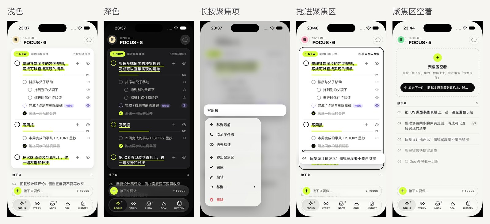
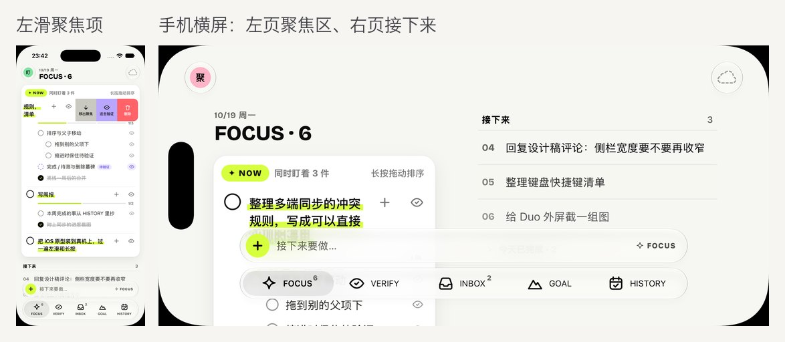
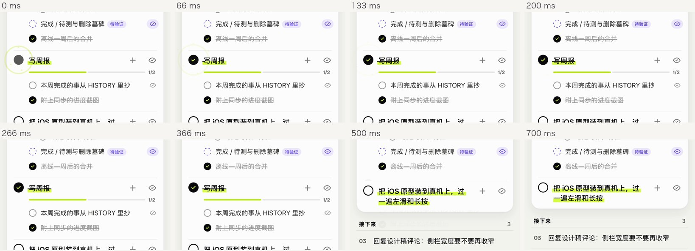
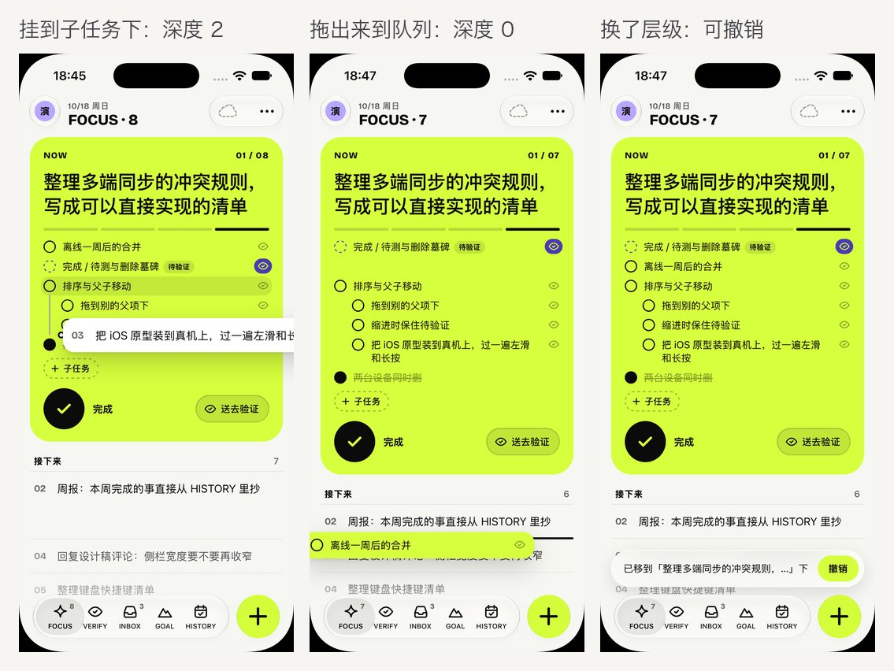
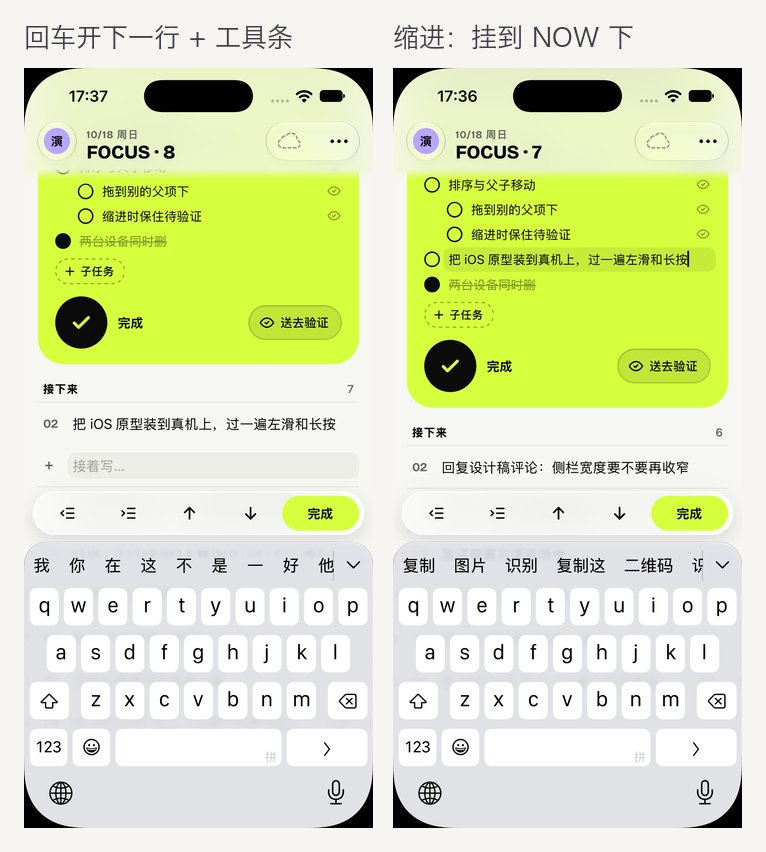
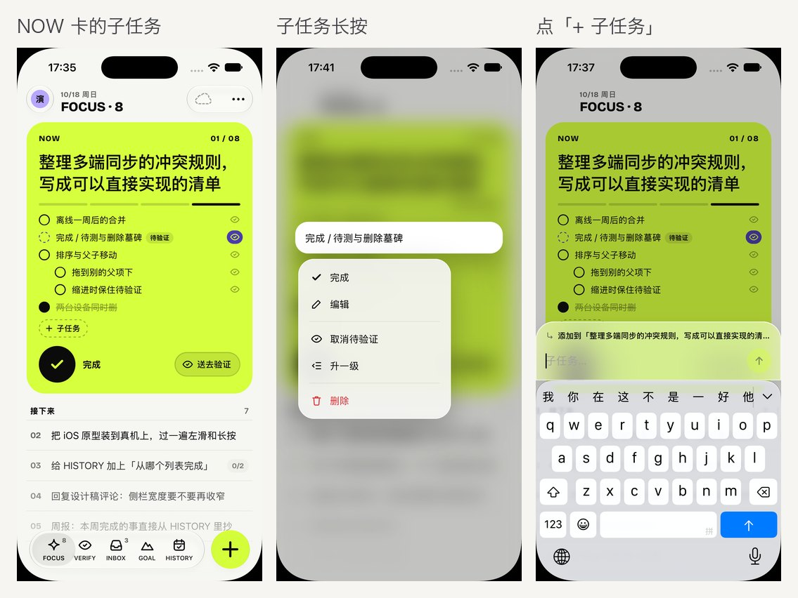
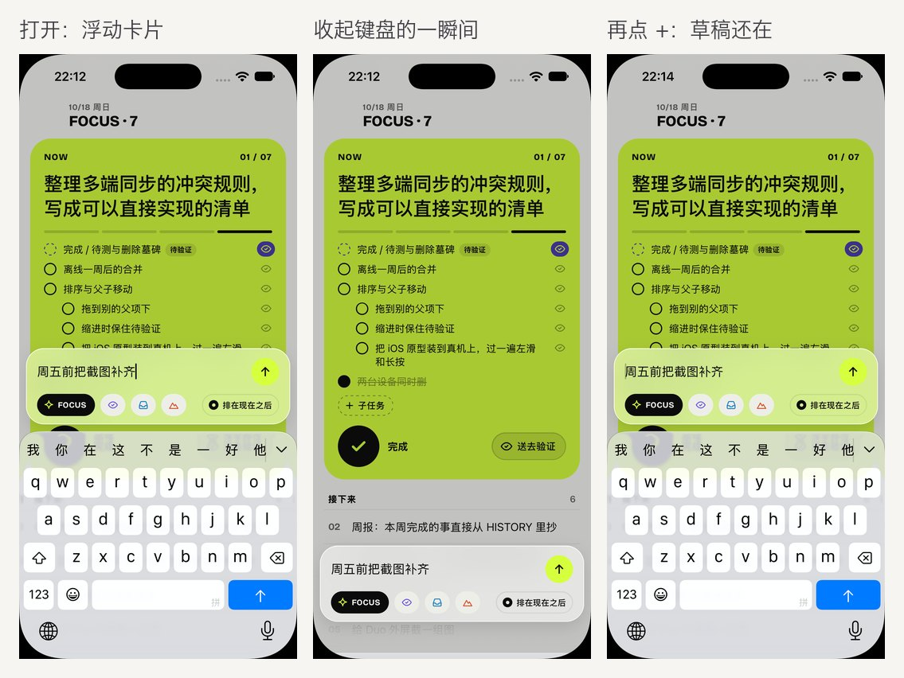
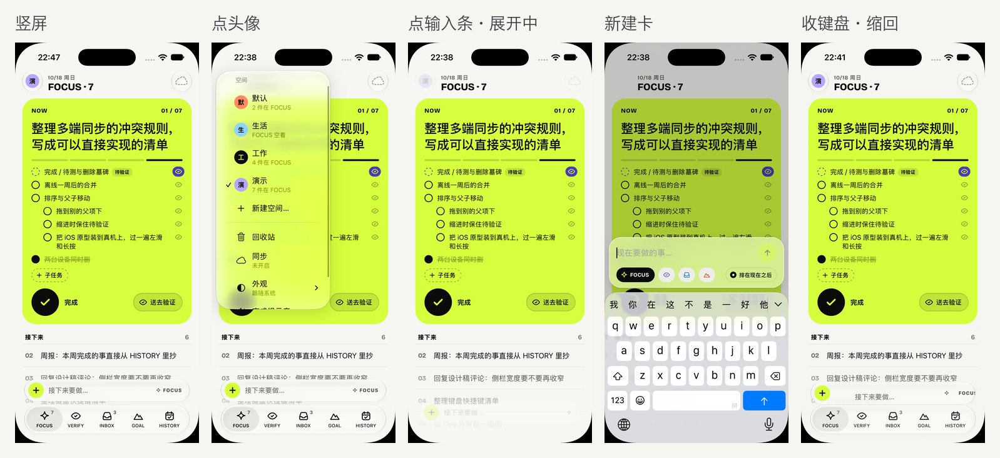
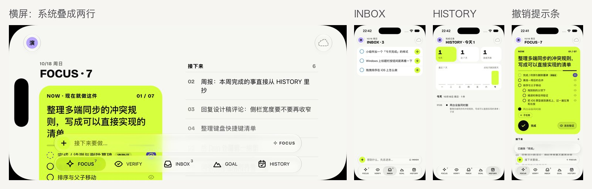
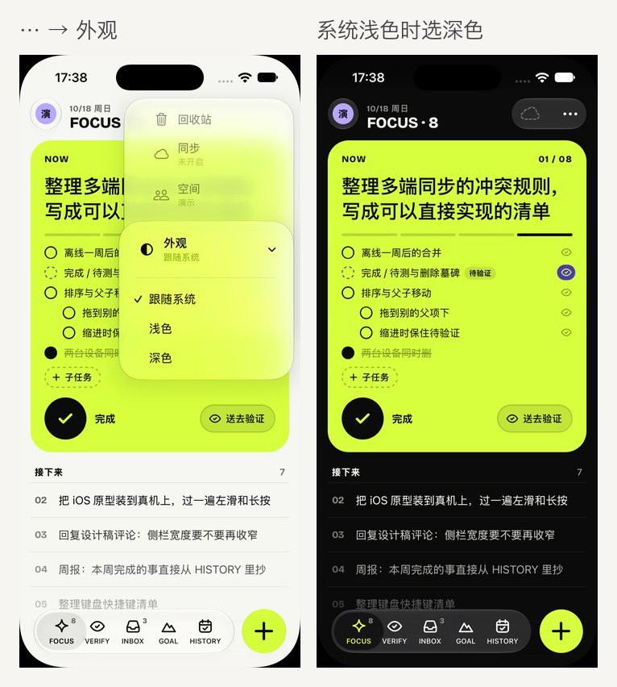

# FOCUS iOS 版（界面原型）

用 Capacitor 8 把一套专为手机重写的 React 界面包成 iOS App。数据逻辑直接复用桌面端的 `src/model.ts` 和 `src/trash.ts`，通过坚果云和桌面端同步（见 [sync.md](sync.md)）。iOS 26 起页签栏、新建输入条和导航栏按钮是系统原生的 Liquid Glass，iPhone Duo 上由系统竖排到侧边（见下文「原生外壳」「iPhone Duo」两节）。

视觉按全平台重设计 F「一件事」（交接包 `design_handoff_focus/`：`screens/iPhone.jpg` P1–P17、`Duo.jpg` U1–U10、`Motion.jpg`、`tokens.css`）；FOCUS 页最上面是能同时盯着几件事的**聚焦区**（2026-10 修订，定稿 P4，和桌面版同一套设计）。

> **聚焦区（2026-10）**：原来一整块荧光绿的 NOW 卡换成了能放几件事的聚焦区面板，和桌面版（`src/components/FocusView.tsx`）同一套结构、颜色和行为，见下文「FOCUS」；交接包 README 的「2026-10 修订：聚焦区」是设计依据。下面「NOW 卡的子任务」「双页」等几张截图还是旧的 NOW 卡。




## 技术路线

- **Capacitor 8 + React 19 + zustand + motion**，和桌面端同一套技术栈。iOS 工程走 Swift Package Manager，不需要 CocoaPods。
- **复用而不改动**：列表的新建、完成（FOCUS / VERIFY 顶层项完成后进 INBOX）、待测、移动、删除进回收站、恢复、清洗全部调用 `src/model.ts` / `src/trash.ts`；类型来自 `src/types.ts`。移动端只新增文件，不改桌面端代码。
- **栏用原生，内容用网页**：iOS 26 起页签栏、新建输入条、导航栏按钮由原生外壳（`ios/App/App/FocusChrome.swift`）画，叠在铺满全屏的网页上面，拿到真正的 Liquid Glass；iPhone Duo 上系统自动把它们和状态栏竖排到侧边。网页只画内容，两边通过一个 Capacitor 插件互通。iOS 26 之前没有 Liquid Glass，退回网页自己画的页签（CSS 毛玻璃）。
- **为什么不选 SwiftUI**：SwiftUI 要把 `model.ts`（以及将来的同步合并逻辑）移植成 Swift，两套代码长期保持行为一致的成本高；原型阶段 Capacitor 能复用约九成逻辑。将来需要小组件、Siri / 快捷指令时，可以在 Capacitor 工程里加原生扩展，或再评估 SwiftUI。

## 目录

```
src/mobile/                 移动端界面（独立入口，不影响桌面构建）
  index.html / main.tsx     入口
  MobileApp.tsx             布局：原生外壳在时导航全交给原生；没有外壳时窄屏用页签、iPad 用侧栏；够宽时分成两页
  chrome.ts                 和原生外壳互通：推状态、接点按事件、把栏占掉的边距 / 折痕写进 CSS 变量
  layout.ts                 双页布局：内容区 ≥ 700pt 时以折痕（没有折痕时以中线）为界分左右两页
  data.ts                   profile、HISTORY 按天分组、示例数据等纯函数（data.test.ts 有单元测试）
  store.ts                  zustand 状态：多个 profile，各自一份 todos + 回收站
  storage.ts                存储适配层（现在用 Capacitor Preferences）
  native.ts                 触感反馈、键盘高度
  actions.ts                带动画 / 触感的高层操作（完成、聚焦项完成、设为现在、送去验证、删除可撤销…）
  drag.ts                   自由拖拽（规则见 docs/drag.md）：摊平可见行、空隙 + 深度、插入线、悬停展开、撤销
  edit.ts                   编辑时调层级：回车开下一行、缩进 / 反缩进、上移 / 下移（换编辑框时不收键盘）
  theme.ts                  外观：跟随系统 / 浅色 / 深色（<html data-theme>，并交给原生设 window 外观）
  fx.ts                     完成时的火花、光圈、飞向页签的星星 / 幽灵卡（减弱动态效果时不放）
  icons.tsx                 设计交接包里的图标（描边 2px，24 网格）
  ui.ts                     仅界面用的临时状态
  transient.ts              编辑草稿、新建卡片里的字、阅读位置的短时备份（页面万一重载时恢复）
  widgetData.ts             主屏小组件的快照（从各空间的 todos 派生，widgetData.test.ts 有单元测试）
  widget.ts                 把快照交给原生插件写进和小组件共享的钥匙串组；处理点小组件打开的 focustodo:// 链接
  components/               导航栏、页签栏、侧栏、FOCUS（聚焦区 + 接下来）、列表行、滑动行、HISTORY、空状态、新建卡片、
                            编辑用的空行和工具条（EditRows）、菜单、面板
  mobile.css                样式（设计 token、浅色 / 深色、提高对比度、降低透明度、减弱动态效果、安全区、动态字体）
ios/                        Capacitor 生成的 Xcode 工程（App 图标、启动屏已改成 FOCUS 的）
  App/App/FocusChrome.swift 原生外壳：Liquid Glass 页签栏 / 导航栏按钮、Duo 的竖排栏和铰链、和网页互通的插件
  App/App/SceneDelegate.swift  根视图（iOS 26 起是原生外壳）、钥匙串和后台时间插件
  App/App/FocusWidgetPlugin.swift   写小组件快照、刷新时间线的原生插件
  App/FocusWidget/                  主屏 / 锁屏小组件（WidgetKit 扩展，SwiftUI）
capacitor.config.json       Capacitor 配置（webDir = dist-ios）
vite.ios.config.mts         移动端的 Vite 配置（端口 5299）
scripts/make-ios-icon.cjs   生成 iOS 图标：默认 / 深色 / 着色三种外观（取 design_handoff_focus/icons，满版、无 alpha）
```

## 界面设计

**五个分区**：FOCUS、VERIFY、INBOX、GOAL 四个列表加 HISTORY。页头是日期一行加「列表名 · 数字」（Bricolage Grotesque 粗体，随应用打包，来自 `@fontsource/bricolage-grotesque`）。数字、页签角标都只数**未完成的顶层项**，不含子任务；GOAL、HISTORY 不挂角标。

**FOCUS：聚焦区 →「接下来」**（`components/FocusContent.tsx`）

- **聚焦区**是一整块圆角 20 的面板：浅色纸白、深色浮起的炭灰（`--z-*`，和桌面 `src/styles.css` 同值）。顶上荧光绿 `✦ NOW` 标签 +「同时盯着 N 件」，右边「长按拖动排序」（从外面拖进来时变成粗体「松手 = 加入聚焦」，整块描边）。荧光绿只留给标签、标题下的荧光笔、进度和完成的勾，不再有大面积荧光绿底配黑字。
- **每件一行**，行间 1px 分隔：24 的完成圈（浅色黑圈、完成后黑底荧光绿勾；深色荧光绿圈）、标题（正文 600，压一道荧光笔：浅色压在字的下半截，深色是字下 2.5px 的荧光绿线；点按原地编辑）、`+` 添加子任务、眼睛送去验证。有 2 个以上子任务时下面是分段进度（完成段荧光绿）和 `1/3`。
- **子任务**和标题文字对齐，每深一级缩 24：点圆圈完成，点标题编辑（回车开下一行、可调层级，见下文），右边小眼睛切换待验证，长按出菜单（完成、编辑、待验证、升一级、删除），长按后也能拖到树上任何位置。超过 8 条可以「收起」（只露前 4 条和「还有 N 条」）。
- **字号跟动态字体走**：根字号是 `-apple-system-body`（默认 17pt），聚焦项标题 1rem、子任务 0.91rem（比原来 NOW 卡上的 14.5 大一档）；Duo 双页 1.06 / 0.94rem，Duo 外屏 0.94 / 0.85rem。
- **触屏没有悬停**：桌面悬停才出的 `↑ / + / ⋯` 在 iOS 上分到三处——`+` 常驻在标题行右侧（看得见的部分 34×28，点按区域 44pt），点开新建卡片，卡上写着「添加到「…」」，可以连续输入；长按菜单：移到最前、添加子任务、送去验证、移出聚焦区、完成、编辑、移到…、删除；左滑：移出聚焦、送去验证、删除（滑到底删除），右滑：完成。
- 其余排在「**接下来**」：序号接着聚焦区往下数，越往后越淡；有子任务的带 `0/2` 胶囊，点开就地展开。左滑照旧有「设为现在」= 放进聚焦区最前。
- **完成聚焦项（820ms）**：圈按下缩到 .82 → 填黑画荧光绿勾、外圈爆开 + 6 颗星芒、标题划线，配完成触感 → 440ms 写入，这一件向上淡出、高度收起，下面的补位 → 一颗星芒飞向 HISTORY 页签。子任务完成和普通行同一套（460ms）。减少动态效果时都换成 150ms。
- **进聚焦区**（设为现在、放进下一件、拖进来、新建并放进聚焦区）：那一件从「接下来」的位置弹簧移上去（和「接下来」的行同一个 `layoutId`），荧光绿闪一下；移出聚焦区时回到「接下来」第一位，同样闪一下。
- **空着**：最后一件做完不自动补。FOCUS 里还有事时是虚线框「聚焦区空着」+ 黑色胶囊「放进下一件：…」，也能直接把「接下来」的一件拖进框里；FOCUS 整个空了时是原来的空状态（Nothing now.）。
- 新建的、从 INBOX 送进来的事默认排在聚焦区后面（新建卡片里「排在聚焦区后面」可以关掉，关掉就放进聚焦区最前；这个开关记在本机）。FOCUS 原本空着时新建的直接进聚焦区。





**其它分区**

- **VERIFY**：做完但还要测的。列表行右边的荧光绿星芒钮把它退回 FOCUS（排在聚焦区后面）；勾掉后回到 INBOX 的「已完成」。
- **INBOX**：随手记。星芒钮一键送进 FOCUS（排在聚焦区后面）。底下是可折叠的「已完成 · N」。
- **GOAL**：每个目标一张卡，下面一行「写下于 M 月 D 日」，**不显示进度**；子任务用右边的折叠钮收起 / 展开。
- **HISTORY**：今天 / 近 7 天 / 连续天数（今天那格荧光绿）、近 7 天柱状图（点柱子跳到那天），下面按天分组：时间、来源列表的小圆点、标题，小字写「父项 › 子项」「在 VERIFY 完成」「含 N 个子项」。点一条可以恢复为未完成、在原列表中查看、删除。
- **空状态**：叠放的空卡片插画、一句大字（Nothing now. / All checked. / Inbox zero. / No goals yet. / Nothing yet.）、一行说明和按钮（FOCUS 空了是「去 INBOX 挑一件」）。

**条目上的操作**：

| 手势 / 控件 | 作用 |
| --- | --- |
| 点圆圈 | 完成（火花 + 划线 + 触感 + 提示音）；星星飞向 HISTORY 页签 |
| 点文字 | 原地编辑，失焦保存；回车开下一行，可调层级（见下文「编辑时调层级」） |
| 右滑 | 完成 / 取消完成，滑过一大半直接执行 |
| 左滑 | 设为现在 · 送去验证（或取消待验证）· 移动 · 删除；拉过按钮全露出的位置再往里一截才算「滑到底」，直接删除 |
| 长按 | 行抬起、背景模糊，弹出玻璃上下文菜单：完成、编辑、添加子任务 / 设为现在、送去验证（VERIFY 里是退回 FOCUS）、升一级（子项）、移到…（二级）/ 删除 |
| 长按后拖动 | 浮起后手指再移动约 8pt：菜单收起，进入自由拖拽（见下文），上下换位置、左右换层级 |
| 星芒钮 | INBOX、VERIFY 的顶层项：送进 FOCUS，排在聚焦区后面 |
| `0/2` 胶囊 | 子任务进度，点按展开 / 收起 |

子任务无限嵌套；子项标为待验证时留在父项下，圆圈变成紫色虚线并挂「待验证」标签（聚焦区里同样）。删除后底部玻璃提示条 5 秒内可撤销；回收站在头像菜单里（恢复 / 彻底删除要再点一次确认 / 清空）。

**自由拖拽**：一棵树里的任何一项都能拖到任何位置——子项拖到外面、外面的项拖进某个子项甚至子子项下面、子子项拖回子项或顶层。规则和桌面一套，见 [drag.md](drag.md)；落点算法是共享的 `src/dragTree.ts`，放下时调 `store.place`。iOS 这边（`src/mobile/drag.ts`）：

- **开始拖**：长按条目浮起——手指不动就松开，照旧是上下文菜单；浮起后手指移动超过约 8pt，菜单收起、进入拖动。左右滑不受影响（没有长按就不会进入拖动）。浮起后拦住 `touchmove`，页面不跟着手指滚。HISTORY、回收站、编辑中的行不能拖。
- **摊平**：开始拖时把看得见的行按显示顺序摊平——聚焦项（标题那一行）和它的子任务、「接下来」和展开的子项、各列表的树（含展开的「已完成」）。每一行在 DOM 上用 `data-drag-row`、`data-depth`、`data-parent`、`data-collapsed` 等标出（`dragRowProps`），折叠着子项的如实标 `collapsed`。
- **空隙 + 深度**：纵坐标落在哪两行的中线之间就是哪个空隙；横坐标每移动约 24pt 深一级 / 浅一级，换级要多越过约 1/4 级（迟滞），夹到空隙允许的范围里（最深是上一行 + 1，最浅是下一行）。
- **反馈**：插入线画在空隙上，左端（带小圆点）缩进到落点深度，深度变化时左右滑动；新父项那一行淡淡的底色，拖到它的子项区时从它的圆圈拉一条竖线到插入线；被拖的那一项连同子孙留下等高的空位，浮起的副本带子孙数角标（`+3`）。
- **悬停展开**：在折叠着子项的行上停 600ms 自动展开（「接下来」的行在界面上展开，列表里的行改数据里的折叠），可以接着往里拖。
- **自动滚动 / 取消**：拖到滚动区上下边缘自动滚，越靠边越快。拖回原处、拖出列表区（导航栏、页签栏上）松手就取消，副本飞回原位（减弱动态效果时直接回去）。
- **放下**：调 `store.place`，副本落到插入线上。换了父项或层级、进出了聚焦区时弹玻璃提示条「已移到「X」下」「已放进聚焦区」「已移出聚焦区」· 撤销，5 秒内可撤销——开始拖时记下了原父项、在同级里的位置和在不在聚焦区，撤销就是用 `place` 放回去。只是同级换位置时不弹。
- **聚焦区**：FOCUS 顶层的落点看手指在不在聚焦区的框里（`data-zone`，含框的上方）：在就进聚焦区（`PlaceTarget.focused = true`），在框下面就回「接下来」；分界那个空隙上插入线画在落点那一边。从外面拖进来时整块描边、提示「松手 = 加入聚焦」（`ui.dropZone`）。聚焦区空着时虚线框也能直接拖进去（不画插入线，框描边就是反馈）。区内排序、子任务随便拖都照 dragTree 的规则；队列项可以拖进聚焦项的子任务，子任务也可以拖出来到队列。
- **Duo 双页**：左页和右页各是这棵树的一段（FOCUS 左页是聚焦区，右页是队列）。左页整页都算聚焦区那一边（聚焦区下面是统计，没有「接下来」），右页是「接下来」。跨页时深度从各自那一页的左边量起；插入线只画在指针所在的那一页，不进折痕区。
- **触感**：浮起 medium，换空隙或换深度 selection，放下 light，取消不给。
- 原生页签栏收不到网页里的拖动，iOS 不做「拖到页签换列表」，换列表用长按菜单里的「移到…」。



**编辑时调层级**（规则和桌面一套，`edit.ts`）：

- **Enter**：保存，并在它后面开一个同级的空行接着写。空行有内容再 Enter 才真正新建（`placement: { after: id }`），并接着开下一行；空行上直接 Enter 就结束。
- **缩进**：挂到上一个同级下面，成为它的最后一个子项（收着的父项会自动展开）。**反缩进**：升一级，排在原父项后面。同级第一个缩进、顶层反缩进时不动，那一行左右抖一下。空行也能缩进 / 反缩进（只是换位置，还没建）。
- **空行上按删除键**：关掉空行，回到上一条接着编辑。
- 软键盘没有 Tab：编辑标题时键盘上方有一条玻璃工具条——反缩进、缩进、上移、下移、完成（FOCUS 顶层在聚焦区和「接下来」的分界上移 / 下移一格就是进 / 出聚焦区）。没有软键盘时（外接键盘、浏览器）它浮在页签栏上面；双页时放在正在编辑的那一页。接了硬件键盘时 Tab / Shift+Tab 也能用（Duo、iPad 上常见）。拼音组字时这些键都不处理。
- 条目挪到树的别处时 React 会换一个编辑框。先把焦点交给一个常驻的隐藏输入框，数据改好、新编辑框出来后再交回去，iOS 的软键盘不会收起；旧编辑框失焦时照常保存文字，光标位置也带过去。正在编辑的那一行会滚到导航栏以下、工具条以上。





**新建**（设计方案 A「底部输入条」，`screens/iOS-nav.jpg` A1–A8）：点页签栏上方的新建输入条——左边荧光绿 `+`，中间是这一页的提示语（FOCUS「接下来要做…」、VERIFY「做完了、还要测一下的事…」、INBOX「想到什么，先丢进来…」、GOAL「写下一个长期目标…」），右边小字是会落到哪个列表；HISTORY 页没有输入条。Duo 竖排时没有输入条，点侧边那一列的 `+`；Duo 内屏双页时 FOCUS 右页顶上还有「接下来要做…」。键盘升起，输入条在原处淡出、玻璃输入卡片跟着键盘浮上来：四个角都是圆角，两侧留边距、和键盘之间留 10pt，键盘起落时卡片跟着上下，不会露出平底。卡片上一排列表芯片（选中的是黑底荧光绿星芒加列表名），FOCUS 时右边是「排在聚焦区后面」开关；回车添加后保持打开，可以连续输入，新的一行撑开并闪一下荧光绿。拼音等输入法组字时的回车只上屏，不会误提交。

- **跟着键盘关**：软键盘收起（键盘上的收起键、下滑收起、点别处让输入框失焦）时卡片一起关掉。只认「软键盘起来过、又落下去」：接硬件键盘时没有软键盘（高度一直是 0 或只有矮矮的快捷栏），不会因此关掉；旋转时系统可能先报收起再报弹出，等 0.2 秒确认键盘真的没回来才关。
- **草稿不丢**：关掉时输入框里没提交的字留着（也存进 `transient.ts`），下次点输入条打开时接着写；提交后才清空。
- **点输入条时先要回第一响应者**：键盘被系统收起后 WebView 不再是第一响应者，网页里再 focus 输入框也弹不出键盘；原生的输入条（和头像菜单的「新建空间…」）在通知网页之前先让 WebView `becomeFirstResponder()`。
- **从输入条长出来**：网页知道输入条的位置（原生报来的 `accessory` 写进 `--acc-left/right/bottom/h`），新建卡关着时就停在输入条那个矩形里（透明），打开时位置、宽度、圆角一起过渡到键盘上方；关掉时反过来回到输入条，原生输入条同时带动画挂回去。
- 底部的撤销提示条等浮层排在输入条上方（原生报的底边距已经算上输入条）。
- 设计 P3 里卡片贴着键盘、下沿是平的；旅行者在真机上觉得像半截卡片，改成了浮动卡片。







**面板**：空间（左滑改名 / 删除）、回收站、同步（状态卡、坚果云设置、设备列表）、冲突（标题二选一、删除与修改、空间被删）、第一次加入云端的提示（合并本机数据 / 以云端为准）。手机上是从底部拉出的面板，顶上露出导航栏和聚焦区的一截；宽屏居中成卡片，双页时只居中在右页。


**外观**：头像菜单里的「外观」可选跟随系统 / 浅色 / 深色，默认跟随系统，存在本机偏好里（不同步），切换后立即生效。网页按 `<html data-theme>` 切配色；原生把 window 的 `overrideUserInterfaceStyle` 设成同一个值，原生页签栏、导航栏按钮、状态栏一起变，WebView 的 `prefers-color-scheme` 也跟着变。原生另存一份（`UserDefaults` 的 `focus.appearance`），下次启动在网页加载前就设好，首屏不闪。小组件仍跟随系统。



**系统适配**：安全区（含 iPhone Duo 的侧边竖排栏）、浅色 / 深色（跟随系统或按「外观」）、提高对比度（分隔线、玻璃描边和次要文字加深，深色下相应调亮）、降低透明度（网页画的玻璃改成实色）、减弱动态效果（不放火花和飞行动画，换场直接切）、动态字体（正文用 `-apple-system-body`）、原生 Liquid Glass 栏（iOS 26 之前网页自己画）、触感反馈（Capacitor Haptics）、关闭双击缩放延迟和长按选字。

**App 图标**：近黑底上一张荧光绿 NOW 卡、黑色星芒，下面压着两张灰卡；默认、深色、着色三种外观（`npm run icon:ios` 从交接包的 SVG 生成）。启动背景是 `#F6F6F2` / `#0B0B0C`。


## 原生外壳：Liquid Glass 页签栏（iOS 26 起）

底部那排页签、页签栏上方的新建输入条、导航栏上的头像 / 云朵都是系统控件，网页在它们底下铺满全屏：

```
窗口
└─ ChromeShellController（FocusChrome.swift）
   ├─ MainViewController：Capacitor 的 WKWebView，铺满全屏，只画内容
   └─ 叠在上面的一层（只有栏本身接触摸，空处的点按交给网页）
      └─ UITabBarController（五个分区 + bottomAccessory 新建输入条）+ UINavigationController（头像、云朵）
```

- **为什么不用 CSS 仿**：WKWebView 里 `backdrop-filter` 只能仿出毛玻璃的样子，没有 Liquid Glass 的折射、高光和随内容变色；而且 Duo 上只有系统的栏才会被系统竖排到侧边。
- **页签图标**用交接包的描边图标（`Assets.xcassets` 里的 `TabFocus` / `TabVerify` / `TabInbox` / `TabGoal` / `TabHistory`，SVG 保留矢量、按模板图上色）。不用 SF Symbols 的 `tray`、`mountain.2` 等：系统页签栏会自动换成它们的实心款，和设计的线性风格不符。
- **选中态**：设计是浅色「荧光绿底 + 近黑」、深色「17% 荧光绿底 + 荧光绿」。但 iOS 26 起玻璃页签栏的选中胶囊是系统玻璃，`UITabBarAppearance.selectionIndicatorTintColor` 和 `selectionIndicatorImage` 都不生效（27.1 实测），所以只给选中项的图标和文字上色：浅色近黑，深色荧光绿；胶囊本身是系统的浅灰 / 深灰玻璃。
- **角标**只给 FOCUS / VERIFY / INBOX，是未完成的顶层项数：不用系统的红底，灰色小字贴在图标右上（`badgeBackgroundColor = .clear`）。
- **新建输入条**：系统页签栏在手机上最多放 5 个页签，第 6 个会被折进「更多」（iOS 27 的 prominent 页签、pinned 页签都试过，同样会折），所以新建不做成页签，5 个页签独占一整行；新建是挂在页签栏上的 `bottomAccessory`（`UITabAccessory`，系统给它画玻璃底）。内容是原生视图 `NewItemAccessoryView`：34 的荧光绿圆 + 近黑加号、15pt 次要色提示语、右边列表图标 + 英文名（10.5 粗体、字距 .06em）；网页每次推状态时带上这一页的提示语和目标列表（HISTORY 为空，原生就 `setBottomAccessory(nil, animated:)`）。键盘起来时先拿掉、落下后再带动画挂回去。读 `tabAccessoryEnvironment`：`.inline`（页签栏收起时并在旁边）只留「+ 提示语」。页签栏 `tabBarMinimizeBehavior = .never`——内容在网页里的滚动容器里滚，系统感知不到，所以输入条常驻，实际不会进 inline。
- **头像菜单**（替代原来的 `⋯` 和点头像开空间面板）：原生 `UIMenu`，用 `UIDeferredMenuElement.uncached` 每次打开时按最新状态现搭。第一组「空间」：每个空间一项（图片是空间头像，副标题是 FOCUS 未完成件数或「FOCUS 空着」，当前空间打勾），最后「新建空间…」打开空间面板并直接进入新建（面板里仍可左滑改名 / 删除）；第二组：回收站（小字是条数）、同步（小字是状态）、外观（二级菜单：跟随系统 / 浅色 / 深色）、完成提示音、触感反馈（开关带勾）。导航栏不再挂自己的溢出项（`additionalOverflowItems = nil`），只有按钮放不下时系统才会自己出 `⋯`。
- **云朵**按同步状态换 SF Symbol 和颜色：已同步 `checkmark.icloud`（绿）、同步中 `arrow.triangle.2.circlepath`（转动）、离线 `icloud.slash`、出错 `exclamationmark.icloud`（红）、未开启 `icloud.dashed`（浅灰）；有冲突时带红色角标，点开冲突面板。
- **头像**是按空间颜色和首字画的图片（八种空间色；黑色那种在深色下反成浅底黑字），点开头像菜单。右上只有一颗云朵。
- **标题**：栏横排时导航栏那一行只有原生的头像和右边的云朵，「日期 / 列表名 · 数字」由网页画在两者之间——原生报来那一行的位置（`nav`：顶、高、头像右边界、云朵左边界），网页写进 `--nav-top/h/left/right`。

**和网页互通**（插件 `FocusChrome`，网页侧在 `src/mobile/chrome.ts`）：

| 方向 | 内容 |
| --- | --- |
| 网页 → 原生 | 当前分区、FOCUS / VERIFY / INBOX 的未完成顶层项数（角标）、设计 token 里原生要用的颜色（跟浅色 / 深色）、空间列表（名字、头像颜色、FOCUS 件数、哪个是当前）、同步状态（图标、冲突数、菜单里的小字）、头像菜单里的回收站条数 / 外观 / 开关状态、新建输入条的提示语和目标列表（HISTORY 为空）、有没有网页弹层、「分区收到东西」的脉冲（页签弹一下） |
| 原生 → 网页 | 点了页签、点了输入条 / `+` / 云朵 / 菜单项（切空间是 `space:<id>`，新建空间是 `newSpace`）；几何信息：栏在系统安全区之外又占掉的边距（写进 `--chrome-top/right/bottom/left`，含输入条）、导航栏那一行的位置（`--nav-*`）、新建输入条的矩形（`accessory` → `--acc-left/right/bottom/h` 和 `data-acc`）、折痕、铰链（`data-hinge`）、栏竖排在哪侧（`data-bar`）、各页签图标的位置（完成 / 送去验证时「飞向某个分区」的终点） |

- 页面开始加载前原生注入 `data-chrome="native"`，网页第一次渲染就不画自己的页签和导航栏按钮，不会闪。网页的第一份状态到之前原生栏先不露出（不知道该选中哪个页签）。
- **浅色 / 深色**：两边各自跟系统走；颜色由网页的 CSS 变量推给原生，换外观时重推一次。
- **键盘**：软键盘真的盖住底部时页签栏和新建输入条一起收起（外接键盘时的小工具条不算），收起期间网页的底边距冻结，内容不跳。
- **网页弹层的层级**：长按菜单、新建卡片、空间 / 回收站 / 同步 / 冲突面板打开时，原生栏整个淡出、不接触摸——它们本该在面板底下，而原生视图永远盖在网页上面。
- **降级**：iOS 26 之前、在浏览器里、或者带启动参数 `-cssChrome` 时没有原生外壳，网页照旧自己画：窄屏是 CSS 毛玻璃页签栏（选中项荧光绿胶囊），上面一条网页画的玻璃新建输入条（`NewBar`，长相、提示语和原生的一样，同样写 `--acc-*`，新建卡同样从它长出来），导航栏是头像、标题和一颗云朵，点头像弹出网页画的「空间 + 设置」菜单（内容和原生头像菜单一样）；宽屏（iPad）是侧栏，右上胶囊里是 `+`、云朵和打开同一个菜单的 `⋯`。

## iPhone Duo

按苹果「Designing for iPhone Duo」做：只看可用空间，不认机型；栏的位置交给系统；内屏用"双页"多显示一层信息，开合时状态连续。

| 姿态 | 窗口 | 栏 | 内容 |
| --- | --- | --- | --- |
| 合上，竖握（外屏） | 466×678，D 形：左边铰链侧近直角，右边大圆角，前摄在右上 | 系统竖排在右侧那一列（84pt）：时间、信号、头像、云朵、`+`，下面是竖着的页签胶囊 | 单页 |
| 合上，横握 | 678×466 | 竖排在摄像头那一侧；放不下时系统把头像、云朵、`+` 收进它自己的 `⋯`，页签全留着（方案 A 之后未复核） | 单页 |
| 展开，横握（内屏） | 951×669 | 竖排在右侧，和外屏同一个位置 | 两页，以折痕为界（中间留 40pt） |
| 半折（书本） | 同上 | 同上 | 和展开一样，不重排 |
| 展开，竖握 | 669×951 | 横排，和 iPhone 一样：导航栏在顶上（和状态栏同一行），新建输入条 + 页签栏在底部 | 单页（折痕是横的，列表滚过它没关系） |


- **栏横排 / 竖排要两种层级**：竖排时用系统标准的"页签控制器里每个页签一个导航控制器"，系统才会把导航按钮和页签排进同一列、放不下时自动收进 `⋯`（外屏横握就放不下）；横排时导航栏在外层、页签控制器在里面（新建输入条挂在这个页签控制器上）。开合、旋转时栏的排法一变，外壳把原生栏整套重搭（网页不动）；布局稳定后还会再核对一次，转的过程中短暂地"没有竖排栏"不会让它搭错。
- **竖排时不挂新建输入条**（外屏、内屏横握）：在 Xcode 27.1 的 Duo 模拟器上实测（启动参数 `-accessoryVertical` 强制挂上），系统不会把 `bottomAccessory` 放进竖条，而是摆成内容区底部横贯两页的一条，跨过折痕、压住两页底部。按设计「放不进竖条就不设」：竖排时 `bottomAccessory = nil`，新建用竖条里一颗荧光绿 prominent `+`（`UIBarButtonItem.style = .prominent`，不和别的按钮共用玻璃底）；内屏双页时 FOCUS 右页顶上的「接下来要做…」照留。手机横屏有输入条，右页顶上就不再放这个框（`:root[data-acc] .addbox`），和设计 A7 一致。
- **双页**（`layout.ts`、`Chrome.tsx` 的 `Panes`）：内容区宽度 ≥ 700pt 就分两页，Duo 内屏横握和手机横屏都是。每个分区的内容分成左右两块（`.pane-l` / `.pane-r`），单页时上下接着排在同一个滚动页里，双页时各自成一个滚动页、以折痕为界——同一份 DOM，开合时不重建。按设计 U4–U6：
  - **FOCUS**：左页聚焦区面板（字号放大一档）+ 今天完成 / 近 7 天 / 连续天数；右页「接下来要做…」新建框 + 接下来 + 可展开的「今天已完成」。手机横屏有底部新建输入条，右页不再放这个框。
  - **VERIFY / INBOX / GOAL**：左页是列表，右页是这个列表的完成记录（按天；FOCUS / VERIFY 完成后挪进 INBOX 的仍记在原列表名下，所以 INBOX 左页的「已完成」可能比右页多）。
  - **HISTORY**：左页统计 + 最近 16 周热力图（点一天，右页跳到那天），右页按天的记录。
  - 聚焦区在单页和双页里是同一个元素：合上时它在外屏单列的顶上，展开后到左页同一位置，「接下来」从下面挪到右页。

  

  上图是 iPhone 17 Pro 上用 `appResize` 开到 Duo 内屏尺寸（栏横排）和手机横屏截的，数据是测试数据；Duo 模拟器上装着真实数据，只核对了布局，没有存截图。
- **不压折痕**：新建卡片放在左页（要加进的列表在那儿），提示条放在右页底下，空间 / 回收站 / 同步 / 冲突面板居中在右页，长按菜单限制在长按的那一页里。
- **折痕的位置**：按 HIG 应该问系统要（`UIView.reservedRegions(kind: .division, options: .includeInactive)`），代码里也问了；但实测在模拟器里这个 App 不论用 UIKit 还是挂一个 SwiftUI `GeometryReader` 都问不到任何保留区域（Capy Pay 用 SwiftUI 的根视图能问到 456–496 的折痕，原因没查明）。所以网页以窗口中线为界兜底——Duo 内屏的折痕正好在中线上，分出来的空档和系统报告的一致。铰链状态（合上 / 半折 / 展平）用 `UIHingeInteraction` 能拿到，写在根节点的 `data-hinge` 上，目前排版不区分。
- **开合时状态连续**：分区、空间在全局状态里；滚动页不卸载，宽度一变就把导航栏下方第一行放回原位（`useScrollAnchor`）；编辑框不卸载，光标还在。重搭原生栏时系统会报一次"选中页签"，网页对同一分区不响应，否则会顺手结束编辑。万一页面被重载，`transient.ts` 兜底恢复草稿和阅读位置。


- **要用 Xcode 27.1 编**：竖排栏、铰链、折痕是 iOS 27.1 SDK 的接口，代码用 `#if canImport(UIKit, _version: 9127.0.85)` 包着，所以 Xcode 27.0 也编得过，但那样编出来的包在 Duo 上跑兼容模式（栏不竖排，App 只占竖排栏以外的区域——此前「看起来没适配」就是这个原因）。这台 Mac 上 27.1 在 `/Applications/Xcode-27.1-RC.app`，系统默认选中的还是 27.0，命令行编译前设 `DEVELOPER_DIR`（见下文「运行」）。
- **模拟器实测方法**：姿态只能在 Xcode 的 Device Hub 窗口底部手动切（合上 / 半折 / 展开 / 旋转），自动化点不了；Duo 合上时模拟器的自动点击也不生效。所以联调时用 `VITE_FOCUS_E2E=1` 的测试包，靠命令队列（见 [sync.md](sync.md)）里只动界面的命令切分区、开面板、读布局（`section`、`ui`、`chrome`、`eval`；`seed` 新建一个演示空间并填上条目，文档截图用，只在测试包里），后台每秒查一次 `xcrun devicectl device info displays` 和 `chrome`，姿态一变就截当前那块屏（`xcrun simctl io <UDID> screenshot --display=<1 外屏 | 3 内屏>`）。启动参数 `-chromeDebug` 会在几何信息里带上键盘 / 页签栏 / 层级状态，并把视图树写到 App 的临时目录。

## 运行

需要 Node.js 22.12+、Xcode 27（含 iOS 27 模拟器运行时）。iPhone Duo 适配要用 **Xcode 27.1** 编（iOS 27.1 SDK 和运行时）。

```bash
npm install
npm run ios:dev      # 浏览器里调界面：http://localhost:5299（数据存 localStorage）
npm run ios:build    # 类型检查 + 构建 dist-ios + 同步到 ios/ 工程
npm run ios:open     # 用 Xcode 打开工程
npm run ios:run      # 构建并装到选择的模拟器 / 真机上运行
npm run icon:ios     # 重新生成 iOS 图标
```

### 模拟器

1. `npm run ios:build`，然后 `npm run ios:open`，在 Xcode 顶部选模拟器（例如 iPhone Duo、iPhone 17 Pro），点运行。给 Duo 用的包要用 Xcode 27.1 打开工程编译，或者在命令行编：

   ```bash
   DEVELOPER_DIR=/Applications/Xcode-27.1-RC.app/Contents/Developer xcodebuild -project ios/App/App.xcodeproj -scheme App -configuration Debug -destination 'platform=iOS Simulator,name=iPhone Duo' -derivedDataPath build/ios-dd build
   ```

   再用 `xcrun simctl install <UDID> build/ios-dd/Build/Products/Debug-iphonesimulator/App.app` 覆盖安装（同一个 bundle id，数据保留）。
2. 或者不开 Xcode：`npx cap run ios --list` 看可用设备，`npx cap run ios --no-sync --target <UDID>`。
3. iPhone Duo 的姿态在 Xcode 27 的 **Device Hub** 窗口底部工具栏切换（合上 / 半开 / 全开、旋转）。命令行能做的：`xcrun devicectl device info displays --device <UDID>` 看当前是哪块屏；常规 iPhone 可以用 `xcrun devicectl device orientation set --device <UDID> landscapeLeft` 旋转。
4. 看网页版导航（iOS 26 之前的样子）：启动时加参数 `-cssChrome`，例如 `xcrun simctl launch <UDID> app.focus.todo -cssChrome`。
5. 改了网页代码后热更新：先 `npm run ios:dev`，再 `npx cap run ios --live-reload --host <本机局域网 IP> --port 5299`。

### 真机（需要旅行者在 Xcode 里操作）

1. iPhone 用数据线连 Mac，在 iPhone 上「设置 › 隐私与安全性 › 开发者模式」打开开发者模式（会重启）。
2. `npm run ios:build && npm run ios:open`。
3. Xcode 左侧选 **App** 工程 › **TARGETS: App** › **Signing & Capabilities**：勾选 *Automatically manage signing*，**Team** 选自己的 Apple 开发者账号；**Bundle Identifier** 默认是 `app.focus.todo`，如果提示已被占用就改成自己的，例如 `com.<你的名字>.focus`（建议同时改 `capacitor.config.json` 的 `appId`）。
4. 顶部设备选自己的 iPhone，点运行。第一次装好后如果提示「不受信任的开发者」，到 iPhone「设置 › 通用 › VPN 与设备管理」里信任。

## 数据与同步

- 数据和桌面端是同一套可同步文档（`src/sync/`）：列表操作全部走 `src/sync/ops.ts`，与桌面端同一条代码路径。
- 本机存储：文档存在 App 私有目录的 `focus-doc.json`（`@capacitor/filesystem`，先写临时文件再改名）；只属于本机的状态（当前空间、分区、提示音、触感、折叠、同步进度）存 Capacitor Preferences。改动后 0.3 秒合并写入，切到后台时立即落盘。
- 从旧版原型升级时，原来 Preferences 里的整份快照会自动迁移。
- 同步：头像菜单 →「同步」填坚果云账号和应用密码（存钥匙串），或点导航栏的云朵图标。WebDAV 请求走 `CapacitorHttp`（原生 URLSession）。打开 / 回到前台立即同步，前台每 15 秒轮询，切到后台时申请后台时间把改动传完。冲突发现时自动弹出底部面板。详见 [sync.md](sync.md)。
- 原生插件（钥匙串、后台时间、外观）写在 `ios/App/App/SceneDelegate.swift` 里的 `FocusNativePlugin`；原生外壳的插件 `FocusChromePlugin` 在 `FocusChrome.swift`，小组件用的 `FocusWidgetPlugin` 在 `FocusWidgetPlugin.swift`。三个都由 `MainViewController` 注册。
- `Info.plist` 只对本机地址放开了明文 HTTP（`NSAllowsLocalNetworking`），给联调用的本机 WebDAV 测试服务器；坚果云走 https。

## 主屏小组件

把「现在这一件」放到主屏上：只展示，不能在小组件里勾选。视觉按定稿设计（`design_handoff_focus/`：README「小组件（WidgetKit）」、`screens/Widgets.jpg`、`design/FWidget.dc.html`）。荧光绿 `#D6FF3D` 只给 NOW；下面的 NEXT 是序号列表，没有勾选圈，免得看起来能点。

| 浅色：大号、中号 / 小号（右边那个固定显示「读书」，FOCUS 空了） | 深色 |
| --- | --- |
|  |  |

| iOS 26 着色 | 锁屏（一行、矩形、圆形）/ FOCUS 空时中、大号列 INBOX（着色模式） |
| --- | --- |
|  |  |

### 显示什么

- **NOW** = 当前空间 FOCUS 里排第一的未完成顶层项：聚焦区第一件，聚焦区空着时是「接下来」第一件；子任务进度 = 已完成子项 / 子项数。**NEXT** = 其后的顶层项（先是聚焦区其余几件，再是「接下来」），按顺序编号 02、03…。
- **件数**：`1/5`、「还有 4 件」、锁屏圆形的数字都是 FOCUS 未完成的**顶层项**数（含 NOW）。
- **今天 / 连续**：「今天 ✓4」「今天 4 件 · 连续 6 天」和 HISTORY 同一套算法（`src/history.ts` 的 `countsByDay` / `streak`，今天还没完成时从昨天往回数）。过了零点小组件自己清零、推算连续天数，不等 App 打开。
- **空状态**：FOCUS 空了显示「Nothing now.」和「INBOX 里有 N 件可以挑」；中号右边、大号下面列 INBOX 最上面三件，点进落在 INBOX。装好后还没打开过 App 时显示「打开 FOCUS 开始」。
- **字体**：`NOW`、`NEXT`、数字、「Nothing now.」用 Bricolage Grotesque 700 / 800（`@fontsource` 里的 latin woff2，iOS 的 CoreText 能直接注册 woff2，扩展的 `Info.plist` 用 `UIAppFonts` 声明，许可证 `Fonts/OFL.txt`）；中文和标题用系统字。字体没注册上时退回 SF Pro Rounded 粗体。

| 尺寸 | 内容 |
| --- | --- |
| 小号 | 浅色整块荧光绿 / 深色底 `#141416`：`✦ NOW · 1/5`，标题贴底，子任务进度条，「还有 4 件 · 今天 ✓4」 |
| 中号 | 左边内缩 8 的荧光绿 NOW 卡（164 宽，圆角 22），右边 NEXT 三件 +「+1 · 今天 ✓4」 |
| 大号 | 上面 NOW 卡（184 高，标题 20，最多两条子任务），下面 NEXT 四件，底部「今天 N 件 · 连续 N 天」+ 空间头像 |
| 锁屏圆形 | ✦ + 剩余件数，外圈 = 今天完成 /（今天完成 + 剩余） |
| 锁屏矩形 | `✦ NOW · 1/5` + NOW 标题两行 |
| 锁屏一行 | ✦ + NOW 标题 |

### 选空间

长按小组件 →「编辑小组件」→「空间」：默认是「跟随 App」，App 切到哪个空间就显示哪个；也可以固定成某个空间。固定了空间的小组件，点开时 App 也会切到那个空间。候选列表来自 App 写的快照，所以 App 至少要打开过一次；固定的空间被删掉后，小组件退回跟随 App。

### 怎么刷新

- 小组件不读同步文档。App 每次数据变化后（本地增删改、同步合并进来的改动、切换空间），`widgetData.ts` 从 store 派生一份精简快照（version 2：各空间的 NOW 及前三条子任务、NEXT 前 8 件、FOCUS 顶层未完成数、INBOX 前三件和总数、今天完成数、连续天数、头像序号），由 `widget.ts` 交给原生插件 `FocusWidget.update`。
- 插件把 JSON 写进 App 和扩展共享的钥匙串组 `<团队前缀>.app.focus.todo.shared`（服务 `app.focus.todo.widget`、账号 `snapshot`），然后调用 `WidgetCenter.reloadTimelines(ofKind: "FocusList")`。不用 App Group 的原因见「签名」。
- 节流：连续改动时最多 0.8 秒写一次；内容和上次一样就不写、不刷新（插件里再比一次钥匙串里的内容）。切到后台时还没写的那一下立即写掉。
- 小组件的时间线在明天、后天 0 点各排一条：今天完成清零，连续天数按天推算（第二天还算上写入那天，再往后就断了）。
- App 不在前台时不会同步，所以别的设备上的改动要等这台 iPhone 打开 FOCUS、同步合并之后才会出现在小组件上。

### 点开

`widgetURL` 是 `focustodo://focus`；FOCUS 空了时中、大号列的是 INBOX，链接是 `focustodo://inbox`。固定了空间的带 `?profile=<id>`。`Info.plist` 注册了 `focustodo` 这个 URL scheme，`widget.ts` 监听 `appUrlOpen`（冷启动时读 `App.getLaunchUrl()`），等数据载入后切空间、切到对应分区、收起面板和菜单。

### 着色、透明、深色

颜色取自 `design_handoff_focus/tokens.json`：浅色白底 / 深色 `#141416`，正文、muted、分隔线各一套；空间头像按定稿的五种配色顺序取（近黑底荧光绿字在深色里反过来）。着色和透明模式下系统去掉底色：NOW 卡变成一层随系统着色的半透明（`widgetAccentable`），`✦ NOW`、序号、进度和锁屏圆形也跟着着色，其余文字白色 55%–95% 分层，头像改成半透明圆。

### 工程

- WidgetKit 扩展 target `FocusWidgetExtension`（bundle id `app.focus.todo.FocusWidget`，iOS 17+，Swift 5），嵌进 App。文件在 `ios/App/FocusWidget/`：
  - `FocusWidget.swift`：时间线、`@main` 入口、支持的尺寸
  - `FocusIntent.swift`：选空间的 AppIntent（`ProfileEntity`、「跟随 App」）
  - `FocusSnapshot.swift`：快照的读取（字段缺了用默认值）
  - `FocusWidgetViews.swift`：各尺寸的界面、配色、Display 字、星芒；改视觉主要改这个文件
  - `Fonts/`：Bricolage Grotesque 700 / 800 的 woff2 和 OFL 许可证（从 `node_modules/@fontsource/bricolage-grotesque` 复制）
- 签名：自动签名，开发团队 `49G26925BS` 写在工程里（换成自己的团队时改 `DEVELOPMENT_TEAM`）。小组件数据走**共享钥匙串组**而不是 App Group：命令行的自动签名不会把新的 App Group 分配给 App ID，描述文件里的 App Group 列表一直是空的，真机构建签不上名；团队的描述文件本来就允许 `<团队前缀>.*` 的钥匙串组，不用去开发者网站或 Xcode 里另外登记。
  - `App/App.entitlements`：`$(AppIdentifierPrefix)app.focus.todo`（排第一，是 App 自己的默认组，同步密码和设备 id 仍存在这里，小组件读不到）和 `$(AppIdentifierPrefix)app.focus.todo.shared`。
  - `FocusWidget/FocusWidget.entitlements`：只有 `…app.focus.todo.shared`。
  - 两边的 Info.plist 都有 `FocusSharedKeychainGroup`，代码从这里读组名。
- 构建（模拟器和真机都不用再传团队；真机第一次构建或换了设备时加 `-allowProvisioningUpdates`）：

```bash
xcodebuild -project ios/App/App.xcodeproj -scheme App -configuration Debug -destination 'platform=iOS Simulator,name=iPhone 18 Pro' build
```

### 联调方法

- 看 App 写的快照（模拟器的钥匙串是个 sqlite 库）：

```bash
sqlite3 "file:$HOME/Library/Developer/CoreSimulator/Devices/<UDID>/data/Library/Keychains/keychain-2-debug.db?mode=ro" "select agrp, length(data) from genp where agrp like '%focus%'"
```

- 模拟器的输入法是拼音，`simctl io` 和 MCP 的 `text` 输不了中文。要准备带中文的测试数据，可以用 `src/sync/migrate.ts` 的 `migrateLegacy` 生成一份同步文档，App 退出后放进 `$(xcrun simctl get_app_container <UDID> app.focus.todo data)/Library/focus-doc.json` 再打开。
- 添加小组件：主屏长按空白处 → 左上角按钮 →「添加小组件」→ 找到 FOCUS；锁屏长按 →「自定义」→ 锁定屏幕。着色 / 透明在主屏长按 → 左上角按钮 →「自定义」里切换。
- 不点小组件也能试链接：`xcrun simctl openurl <UDID> "focustodo://inbox?profile=<空间 id>"`（系统会先问一次「在 FOCUS 中打开？」）。

## 已知问题

- **拖拽的验证范围**：iPhone 17 Pro 上用真实触摸（模拟器的 touch_path）验过挂到子任务下、拖出来到队列、拖出列表区取消、撤销提示条；拖进 / 拖出聚焦区（含撤销）、区内落到子任务之间也在 iPhone 17 Pro 上用真实触摸验过；悬停展开、双页跨页拖动在浏览器里用合成的触摸事件验过。Duo 上的跨页拖动、真机手感（深度换算的 24pt、迟滞）要旅行者手动试。
- **页签选中态不是荧光绿底**：系统玻璃页签栏的选中胶囊不能着色（见「原生外壳」），只有图标和文字上色。要完全照设计，只能自己画页签栏，就丢了系统的 Liquid Glass 和 Duo 竖排。
- **Duo 竖排栏里「+」的位置**：设计（U1 / U4、方案 A 的 A5 / A6）把 58 的 `+` 放在竖条最下面、页签胶囊下面单独一颗；现在是系统竖排栏里头像、云朵下面的 prominent 按钮（竖排时页签控制器由系统摆，胶囊几乎贴到底，没法在它下面再挂一颗）。
- **手机横屏输入条和页签栏不在同一行**：设计 A7 是并排一行；实测系统在横屏也按 regular 摆法把输入条叠在页签栏上方，只有页签栏收起（minimize）时才会并成一行（inline），而没有接口能直接要 inline。
- **输入条不随滚动收成 inline 窄版**：内容在网页的滚动容器里滚，系统感知不到，`tabBarMinimizeBehavior` 设成 `.never`，输入条常驻（设计允许）。窄版的排法（只留「+ 提示语」）写好了，但实际用不到。
- **「原地长成新建卡」是两层配合出来的**：原生输入条随键盘拿掉（系统动画），网页的新建卡从输入条同一个矩形长到键盘上方；不是同一个视图的形变，展开的前一两帧能看到输入条淡出、卡片淡入。
- **只在模拟器上验证过**：没有真机；模拟器用的是硬件键盘，软键盘弹出时新建卡片贴键盘、页签栏收起的效果还需要真机确认。
- **聚焦区在 Duo 上只看了空 FOCUS 的双页**：Duo 模拟器上是旅行者的真实数据，两个空间的 FOCUS 都空着，不能造数据，所以 Duo 内屏只核对了「FOCUS 空着」时左页空状态 + 统计、右页新建框的排法；聚焦区面板在双页里的样子是在 iPhone 17 Pro 横屏（同一套 `is-spread` 双页）上用测试数据看的。
- **和桌面聚焦区不一样的地方**：触屏没有悬停，`↑ / ⋯` 收进长按菜单和左滑，`+` 常驻在标题行右侧；聚焦项前面没有拖拽点（长按整行就能拖）；「+」打开的是底部新建卡片（可以连续输入），桌面是在子任务最后开一个空行；进聚焦区的弹簧移动用 motion 的 `layoutId`（和「接下来」的行共享），桌面是 WAAPI 从那一行的位置移过去；Duo 双页时左页整页都算聚焦区那一边。
- **新视觉在 Duo 上只看了内屏展开横握**：外屏、半折、旋转要在 Device Hub 里手动切姿态，留给旅行者核对（上面「各姿态」「开合时编辑不中断」两张图还是旧视觉）。
- **折痕问不到**：见「iPhone Duo」一节，以窗口中线兜底；真机上要再确认一次 `reservedRegions` 能不能问到。
- **未在 iOS 26 上实测**：原生外壳从 iOS 26 起启用，但这次只用 iOS 27 / 27.1 模拟器验过；iOS 26 上 `bottomAccessory` / `UITabAccessory`、`tabAccessoryEnvironment`、带 `UIMenu` 的头像按钮、prominent 按钮用的都是 26 就有的接口。
- **「半折」立着当小笔记本（内屏竖握半折）**没有专门做上下分屏，照单页排；折痕横穿列表时只是列表滚过它。
- **Duo 外屏横握**空间太小，系统把头像、云朵、`+` 收进它自己的 `⋯`（页签优先）；要新建得点 `⋯` → 新建，或者转回竖握。方案 A 去掉了我们自己的 `⋯` 菜单项，这个姿态下的样子要在 Device Hub 里切姿态后复核。

## 与桌面端的衔接

- 两端共用 `src/model.ts`、`src/types.ts` 和整个 `src/sync/`；profile 和数据结构已经统一，桌面和手机的数据通过坚果云互通。
- `tsconfig.json` 包含 `src/`，桌面端类型检查也会检查 `src/mobile/`。
- 移动端的 HISTORY 按天分组仍在 `src/mobile/data.ts`，和桌面端的 `src/history.ts` 各有一份，以后可以合并。
