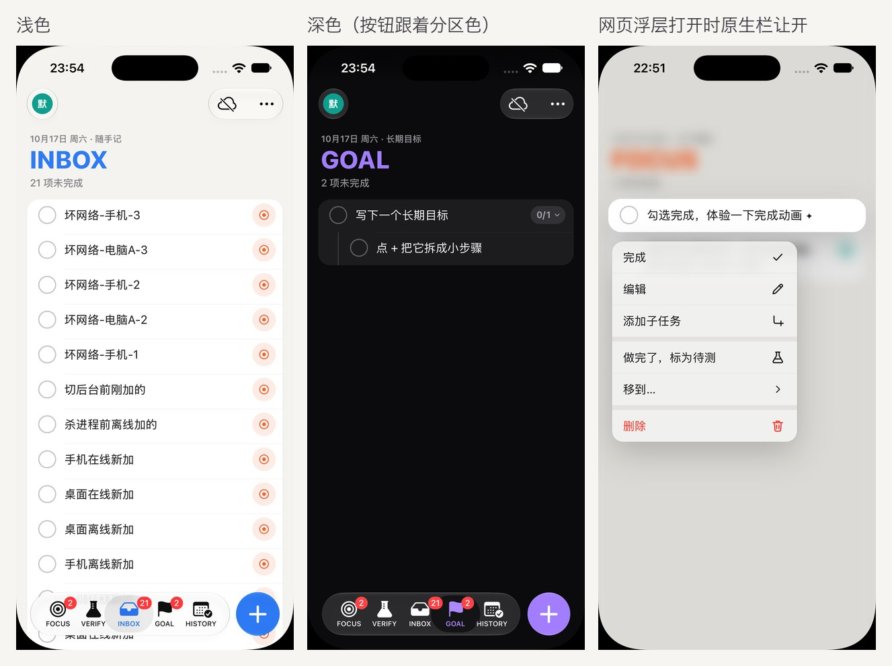
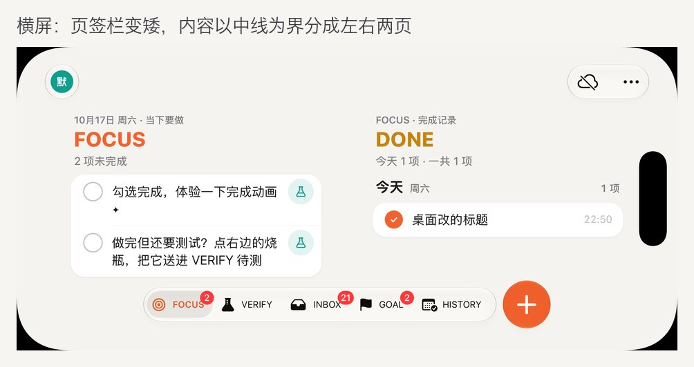
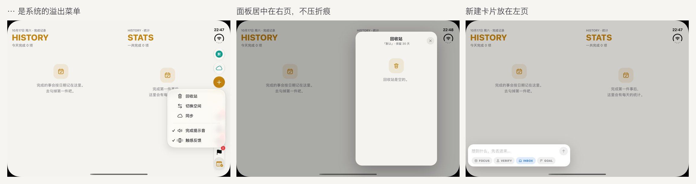
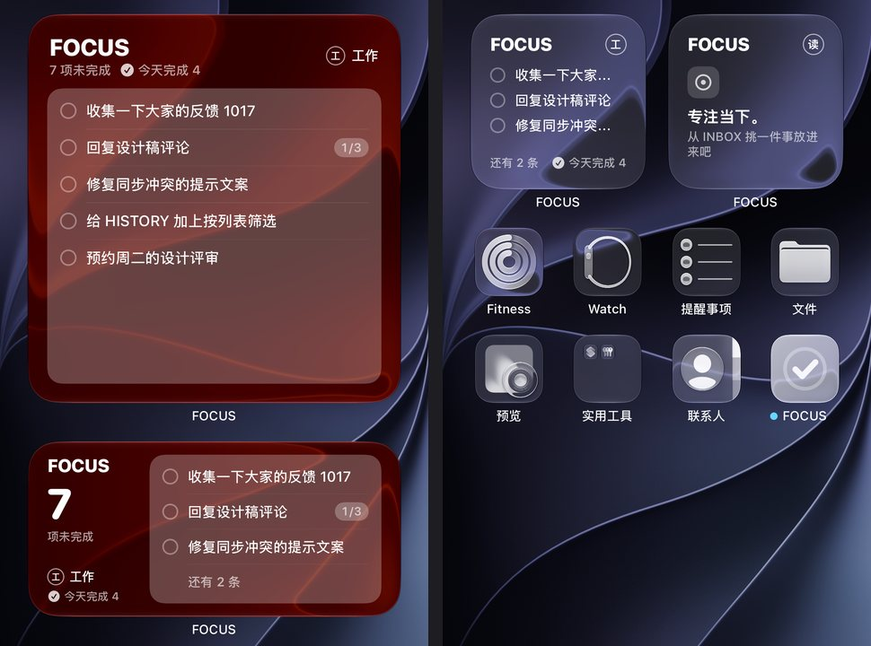
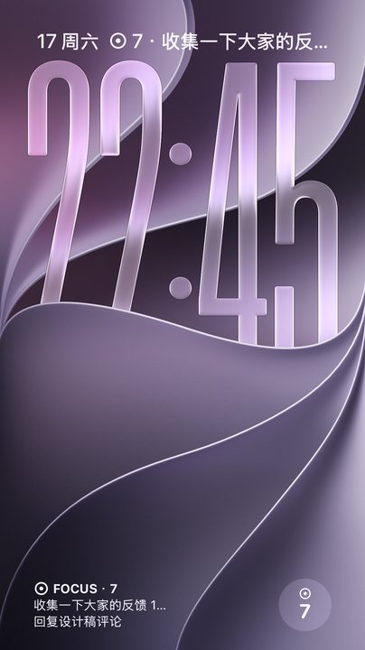

# FOCUS iOS 版（界面原型）

用 Capacitor 8 把一套专为手机重写的 React 界面包成 iOS App。数据逻辑直接复用桌面端的 `src/model.ts` 和 `src/trash.ts`，通过坚果云和桌面端同步（见 [sync.md](sync.md)）。iOS 26 起页签栏、「+」和导航栏按钮是系统原生的 Liquid Glass，iPhone Duo 上由系统竖排到侧边（见下文「原生外壳」「iPhone Duo」两节）。




## 技术路线

- **Capacitor 8 + React 19 + zustand + motion**，和桌面端同一套技术栈。iOS 工程走 Swift Package Manager，不需要 CocoaPods。
- **复用而不改动**：列表的新建、完成（FOCUS / VERIFY 顶层项完成后进 INBOX）、待测、移动、删除进回收站、恢复、清洗全部调用 `src/model.ts` / `src/trash.ts`；类型来自 `src/types.ts`。移动端只新增文件，不改桌面端代码。
- **栏用原生，内容用网页**：iOS 26 起页签栏、「+」、导航栏按钮由原生外壳（`ios/App/App/FocusChrome.swift`）画，叠在铺满全屏的网页上面，拿到真正的 Liquid Glass；iPhone Duo 上系统自动把它们和状态栏竖排到侧边。网页只画内容，两边通过一个 Capacitor 插件互通。iOS 26 之前没有 Liquid Glass，退回网页自己画的页签（CSS 毛玻璃）。
- **为什么不选 SwiftUI**：SwiftUI 要把 `model.ts`（以及将来的同步合并逻辑）移植成 Swift，两套代码长期保持行为一致的成本高；原型阶段 Capacitor 能复用约九成逻辑。将来需要小组件、Siri / 快捷指令时，可以在 Capacitor 工程里加原生扩展，或再评估 SwiftUI。

## 目录

```
src/mobile/                 移动端界面（独立入口，不影响桌面构建）
  index.html / main.tsx     入口
  MobileApp.tsx             布局：原生外壳在时导航全交给原生；没有外壳时窄屏用页签、iPad 用侧栏；够宽时分成两页
  chrome.ts                 和原生外壳互通：推状态、接点按事件、把栏占掉的边距 / 折痕写进 CSS 变量
  layout.ts                 双页布局：内容区 ≥ 700pt 时以折痕（没有折痕时以中线）为界分左右两页
  data.ts                   profile、HISTORY 按天分组、示例数据等纯函数（data.test.ts 有单元测试）
  store.ts                  zustand 状态：多个 profile，各自一份 todos + 回收站
  storage.ts                存储适配层（现在用 Capacitor Preferences）
  native.ts                 触感反馈、键盘高度
  actions.ts                带动画 / 触感的高层操作
  ui.ts                     仅界面用的临时状态
  transient.ts              编辑草稿、新建卡片里的字、阅读位置的短时备份（页面万一重载时恢复）
  widgetData.ts             主屏小组件的快照（从各空间的 todos 派生，widgetData.test.ts 有单元测试）
  widget.ts                 把快照交给原生插件写进 App Group；处理点小组件打开的 focustodo:// 链接
  components/               导航栏、标签栏、侧栏、条目行、滑动行、HISTORY、新建卡片、菜单、面板、双页的右页（Companion）
  mobile.css                样式（浅色 / 深色、安全区、动态字体）
ios/                        Capacitor 生成的 Xcode 工程（App 图标、启动屏已改成 FOCUS 的）
  App/App/FocusChrome.swift 原生外壳：Liquid Glass 页签栏 / 导航栏按钮、Duo 的竖排栏和铰链、和网页互通的插件
  App/App/SceneDelegate.swift  根视图（iOS 26 起是原生外壳）、钥匙串和后台时间插件
  App/App/FocusWidgetPlugin.swift   写小组件快照、刷新时间线的原生插件
  App/FocusWidget/                  主屏 / 锁屏小组件（WidgetKit 扩展，SwiftUI）
capacitor.config.json       Capacitor 配置（webDir = dist-ios）
vite.ios.config.mts         移动端的 Vite 配置（端口 5299）
scripts/make-ios-icon.cjs   生成 iOS 图标（满版、无 alpha）
```

## 界面设计

**五个分区**：FOCUS、VERIFY、INBOX、GOAL 四个列表加 HISTORY。每个分区有自己的主题色，大标题、选中态、空状态、页签栏的选中色和「+」都跟着变；列表的未完成数显示在页签角标上。

**Profile（界面上叫「空间」）**：例如「工作」「生活」，每个空间有独立的列表和回收站。点导航栏左上角的头像（网页版侧栏形态是侧栏顶部的空间卡片）打开面板，可切换、新建、改名、删除（删除需再点一次确认，至少保留一个）。

**新建**：点页签栏旁边的 `+`（Duo 竖排栏里是侧边那一列的 `+`）。底部弹出贴着键盘的输入卡片，可选放进哪个列表；回车添加后保持打开，可以连续输入。拼音等输入法组字时的回车只上屏，不会误提交。

**条目上的操作**（尽量贴近 iOS 习惯）：

| 手势 / 控件 | 作用 |
| --- | --- |
| 点圆圈 | 完成（弹跳 + 粒子 + 划线 + 触感 + 提示音）；FOCUS / VERIFY 顶层项完成后飞向 HISTORY |
| 点文字 | 原地编辑，回车 / 失焦保存 |
| 右滑 | 完成 / 取消完成，滑过一大半直接执行 |
| 左滑 | INBOX：送进 FOCUS；VERIFY：退回 FOCUS；其它：标为待测。另有「移动」「删除」，滑到底直接删除 |
| 长按 | iOS 式上下文菜单：完成、编辑、添加子任务、标为待测 / 退回 FOCUS、移到…（二级菜单）、删除 |
| 右侧圆按钮 | 与桌面一致：INBOX 顶层项 ◎ 送进 FOCUS，FOCUS 顶层项烧瓶标为待测 |
| `1/3 ⌄` 胶囊 | 子任务进度，点按折叠 / 展开 |

子任务无限嵌套，用缩进和层级竖线表示；子项标为待测时留在父项下，勾选圈变成青绿虚线并挂「待测」标签。已完成的顶层项收在「已完成」分组里，可折叠。删除后底部提示条 5 秒内可撤销；右上角 `⋯`（系统的溢出菜单）里有回收站（恢复 / 彻底删除 / 清空）、切换空间、同步、完成提示音和触感反馈开关。

**HISTORY**：顶部是今天 / 近 7 天 / 连续天数和 7 天柱状图（点柱子跳到那天），下面按日期分组列出完成的事。父项当天一起完成的子项折叠成「含 N 个子项」；子项单独完成时带上父项路径。点某条可以「标记为未完成」「在某列表中查看」或删除。

**系统适配**：安全区（含 iPhone Duo 的侧边竖排栏）、浅色 / 深色实时跟随、动态字体（正文用 `-apple-system-body`，随系统字号缩放）、原生 Liquid Glass 栏（iOS 26 之前是 CSS 毛玻璃）、触感反馈（Capacitor Haptics）、关闭双击缩放延迟和长按选字。

## 原生外壳：Liquid Glass 页签栏（iOS 26 起）

底部那排页签、旁边的 `+`、导航栏上的头像 / 云朵 / `⋯` 都是系统控件，网页在它们底下铺满全屏：

```
窗口
└─ ChromeShellController（FocusChrome.swift）
   ├─ MainViewController：Capacitor 的 WKWebView，铺满全屏，只画内容
   └─ 叠在上面的一层（只有栏本身接触摸，空处的点按交给网页）
      └─ UITabBarController（五个分区）+ UINavigationController（头像、同步、⋯）+ 「+」
```

- **为什么不用 CSS 仿**：WKWebView 里 `backdrop-filter` 只能仿出毛玻璃的样子，没有 Liquid Glass 的折射、高光和随内容变色；而且 Duo 上只有系统的栏才会被系统竖排到侧边。
- **「+」**：系统页签栏在手机上最多放 5 个页签，第 6 个会被折进「更多」（iOS 27 的 prominent 页签、pinned 页签都试过，同样会折），所以「+」不做成页签：栏横排时是页签栏右边一颗独立的玻璃圆钮（`UIButton.Configuration.prominentGlass()`，分区色），页签栏收窄让位；栏竖排时是侧边那一列里的 prominent 按钮。
- **`⋯`** 用系统的溢出菜单（`UINavigationItem.additionalOverflowItems`）：回收站、切换空间、同步、提示音、触感（开关带勾）。HIG 要求自己的溢出菜单并进系统的，Duo 上放不下的按钮也会自动收进这里。
- **云朵**按同步状态换图标和颜色（已同步青绿、离线 / 限流琥珀、出错红色、未开启斜杠），有冲突时带红色角标，点开冲突面板。
- **头像**是按空间颜色和首字画的图片，点开空间面板。

**和网页互通**（插件 `FocusChrome`，网页侧在 `src/mobile/chrome.ts`）：

| 方向 | 内容 |
| --- | --- |
| 网页 → 原生 | 当前分区、各列表未完成数（角标）、各分区主题色（跟浅色 / 深色）、空间名和颜色、同步状态、`⋯` 里的开关状态、滚过大标题后导航栏的小标题、有没有网页弹层、「分区收到东西」的脉冲（页签弹一下） |
| 原生 → 网页 | 点了页签、点了 `+` / 头像 / 云朵 / 菜单项；几何信息：栏在系统安全区之外又占掉的边距（写进 `--chrome-top/right/bottom/left`）、折痕、铰链（`data-hinge`）、栏竖排在哪侧（`data-bar`）、各页签图标的位置（完成 / 移动条目时「飞向某个分区」的终点） |

- 页面开始加载前原生注入 `data-chrome="native"`，网页第一次渲染就不画自己的页签和导航栏按钮，不会闪。网页的第一份状态到之前原生栏先不露出（不知道该选中哪个页签）。
- **浅色 / 深色**：两边各自跟系统走；分区色由网页的 CSS 变量推给原生，换外观时重推一次。
- **键盘**：软键盘真的盖住底部时页签栏和 `+` 收起（外接键盘时的小工具条不算），收起期间网页的底边距冻结，内容不跳。
- **网页弹层的层级**：长按菜单、新建卡片、空间 / 回收站 / 同步 / 冲突面板打开时，原生栏整个淡出、不接触摸——它们本该在面板底下，而原生视图永远盖在网页上面。
- **降级**：iOS 26 之前、在浏览器里、或者带启动参数 `-cssChrome` 时没有原生外壳，网页照旧自己画页签（窄屏）和侧栏（iPad）：

  | 网页版导航：子任务与待测 | HISTORY（深色） | 空间面板（深色） |
  | --- | --- | --- |
  |  |  |  |

| iPhone 横屏 | Duo 内屏：`⋯` 菜单、面板、新建卡片 |
| --- | --- |
|  |  |

## iPhone Duo

按苹果「Designing for iPhone Duo」做：只看可用空间，不认机型；栏的位置交给系统；内屏用"双页"多显示一层信息，开合时状态连续。

| 姿态 | 窗口 | 栏 | 内容 |
| --- | --- | --- | --- |
| 合上，竖握（外屏） | 466×678，D 形：左边铰链侧近直角，右边大圆角，前摄在右上 | 系统竖排在右侧那一列（84pt）：时间、信号、头像、云朵、`+`、`⋯`，下面是竖着的页签胶囊 | 单页 |
| 合上，横握 | 678×466 | 竖排在摄像头那一侧；放不下时头像、云朵、`+` 收进 `⋯`，页签全留着 | 单页 |
| 展开，横握（内屏） | 951×669 | 竖排在右侧，和外屏同一个位置 | 两页，以折痕为界（中间留 40pt） |
| 半折（书本） | 同上 | 同上 | 和展开一样，不重排 |
| 展开，竖握 | 669×951 | 横排：导航栏在顶上（和状态栏同一行），页签栏 + `+` 在底部 | 单页（折痕是横的，列表滚过它没关系） |

- **栏横排 / 竖排要两种层级**：竖排时用系统标准的"页签控制器里每个页签一个导航控制器"，系统才会把导航按钮和页签排进同一列、放不下时自动收进 `⋯`（外屏横握就放不下）；横排时导航栏在外层、页签控制器在里面，才能只收窄页签栏给 `+` 让位。开合、旋转时栏的排法一变，外壳把原生栏整套重搭（网页不动）；布局稳定后还会再核对一次，转的过程中短暂地"没有竖排栏"不会让它搭错。
- **双页**（`layout.ts`、`components/Companion.tsx`）：内容区宽度 ≥ 700pt 就分两页，Duo 内屏横握和手机横屏都是。左页就是当前分区本身——和外屏是同一个滚动页，只是收窄到折痕左边，所以开合时列表不重建；右页是外屏上没有的"多出来的一层"：四个列表的右页是这个列表的完成记录（按天，FOCUS / VERIFY 完成后挪进 INBOX 的仍记在原列表名下），HISTORY 的右页是统计（7 天柱状图，点柱子让左页跳到那天；按列表分的近 7 天 / 累计）。勾掉一条时它飞向右页的「DONE」。视觉定稿后右页内容可以再换，分页机制不用动。
- **不压折痕**：新建卡片放在左页（要加进的列表在那儿），提示条放在右页底下，空间 / 回收站 / 同步 / 冲突面板居中在右页，长按菜单限制在长按的那一页里。
- **折痕的位置**：按 HIG 应该问系统要（`UIView.reservedRegions(kind: .division, options: .includeInactive)`），代码里也问了；但实测在模拟器里这个 App 不论用 UIKit 还是挂一个 SwiftUI `GeometryReader` 都问不到任何保留区域（Capy Pay 用 SwiftUI 的根视图能问到 456–496 的折痕，原因没查明）。所以网页以窗口中线为界兜底——Duo 内屏的折痕正好在中线上，分出来的空档和系统报告的一致。铰链状态（合上 / 半折 / 展平）用 `UIHingeInteraction` 能拿到，写在根节点的 `data-hinge` 上，目前排版不区分。
- **开合时状态连续**：分区、空间在全局状态里；滚动页不卸载，宽度一变就把导航栏下方第一行放回原位（`useScrollAnchor`）；编辑框不卸载，光标还在。重搭原生栏时系统会报一次"选中页签"，网页对同一分区不响应，否则会顺手结束编辑。万一页面被重载，`transient.ts` 兜底恢复草稿和阅读位置。


- **要用 Xcode 27.1 编**：竖排栏、铰链、折痕是 iOS 27.1 SDK 的接口，代码用 `#if canImport(UIKit, _version: 9127.0.85)` 包着，所以 Xcode 27.0 也编得过，但那样编出来的包在 Duo 上跑兼容模式（栏不竖排，App 只占竖排栏以外的区域——此前「看起来没适配」就是这个原因）。这台 Mac 上 27.1 在 `/Applications/Xcode-27.1-RC.app`，系统默认选中的还是 27.0，命令行编译前设 `DEVELOPER_DIR`（见下文「运行」）。
- **模拟器实测方法**：姿态只能在 Xcode 的 Device Hub 窗口底部手动切（合上 / 半折 / 展开 / 旋转），自动化点不了；Duo 合上时模拟器的自动点击也不生效。所以联调时用 `VITE_FOCUS_E2E=1` 的测试包，靠命令队列（见 [sync.md](sync.md)）里只动界面的命令切分区、开面板、读布局（`section`、`ui`、`chrome`、`eval`），后台每秒查一次 `xcrun devicectl device info displays` 和 `chrome`，姿态一变就截当前那块屏（`xcrun simctl io <UDID> screenshot --display=<1 外屏 | 3 内屏>`）。启动参数 `-chromeDebug` 会在几何信息里带上键盘 / 页签栏 / 层级状态，并把视图树写到 App 的临时目录。

## 运行

需要 Node.js 22.12+、Xcode 27（含 iOS 27 模拟器运行时）。iPhone Duo 适配要用 **Xcode 27.1** 编（iOS 27.1 SDK 和运行时）。

```bash
npm install
npm run ios:dev      # 浏览器里调界面：http://localhost:5299（数据存 localStorage）
npm run ios:build    # 类型检查 + 构建 dist-ios + 同步到 ios/ 工程
npm run ios:open     # 用 Xcode 打开工程
npm run ios:run      # 构建并装到选择的模拟器 / 真机上运行
npm run icon:ios     # 重新生成 iOS 图标
```

### 模拟器

1. `npm run ios:build`，然后 `npm run ios:open`，在 Xcode 顶部选模拟器（例如 iPhone Duo、iPhone 17 Pro），点运行。给 Duo 用的包要用 Xcode 27.1 打开工程编译，或者在命令行编：

   ```bash
   DEVELOPER_DIR=/Applications/Xcode-27.1-RC.app/Contents/Developer xcodebuild -project ios/App/App.xcodeproj -scheme App -configuration Debug -destination 'platform=iOS Simulator,name=iPhone Duo' -derivedDataPath build/ios-dd build
   ```

   再用 `xcrun simctl install <UDID> build/ios-dd/Build/Products/Debug-iphonesimulator/App.app` 覆盖安装（同一个 bundle id，数据保留）。
2. 或者不开 Xcode：`npx cap run ios --list` 看可用设备，`npx cap run ios --no-sync --target <UDID>`。
3. iPhone Duo 的姿态在 Xcode 27 的 **Device Hub** 窗口底部工具栏切换（合上 / 半开 / 全开、旋转）。命令行能做的：`xcrun devicectl device info displays --device <UDID>` 看当前是哪块屏；常规 iPhone 可以用 `xcrun devicectl device orientation set --device <UDID> landscapeLeft` 旋转。
4. 看网页版导航（iOS 26 之前的样子）：启动时加参数 `-cssChrome`，例如 `xcrun simctl launch <UDID> app.focus.todo -cssChrome`。
5. 改了网页代码后热更新：先 `npm run ios:dev`，再 `npx cap run ios --live-reload --host <本机局域网 IP> --port 5299`。

### 真机（需要旅行者在 Xcode 里操作）

1. iPhone 用数据线连 Mac，在 iPhone 上「设置 › 隐私与安全性 › 开发者模式」打开开发者模式（会重启）。
2. `npm run ios:build && npm run ios:open`。
3. Xcode 左侧选 **App** 工程 › **TARGETS: App** › **Signing & Capabilities**：勾选 *Automatically manage signing*，**Team** 选自己的 Apple 开发者账号；**Bundle Identifier** 默认是 `app.focus.todo`，如果提示已被占用就改成自己的，例如 `com.<你的名字>.focus`（建议同时改 `capacitor.config.json` 的 `appId`）。
4. 顶部设备选自己的 iPhone，点运行。第一次装好后如果提示「不受信任的开发者」，到 iPhone「设置 › 通用 › VPN 与设备管理」里信任。

## 数据与同步

- 数据和桌面端是同一套可同步文档（`src/sync/`）：列表操作全部走 `src/sync/ops.ts`，与桌面端同一条代码路径。
- 本机存储：文档存在 App 私有目录的 `focus-doc.json`（`@capacitor/filesystem`，先写临时文件再改名）；只属于本机的状态（当前空间、分区、提示音、触感、折叠、同步进度）存 Capacitor Preferences。改动后 0.3 秒合并写入，切到后台时立即落盘。
- 从旧版原型升级时，原来 Preferences 里的整份快照会自动迁移。
- 同步：`⋯` 菜单 →「同步」填坚果云账号和应用密码（存钥匙串），或点导航栏的云朵图标。WebDAV 请求走 `CapacitorHttp`（原生 URLSession）。打开 / 回到前台立即同步，前台每 15 秒轮询，切到后台时申请后台时间把改动传完。冲突发现时自动弹出底部面板。详见 [sync.md](sync.md)。
- 原生插件（钥匙串、后台时间）写在 `ios/App/App/SceneDelegate.swift` 里的 `FocusNativePlugin`；原生外壳的插件 `FocusChromePlugin` 在 `FocusChrome.swift`，小组件用的 `FocusWidgetPlugin` 在 `FocusWidgetPlugin.swift`。三个都由 `MainViewController` 注册。
- `Info.plist` 只对本机地址放开了明文 HTTP（`NSAllowsLocalNetworking`），给联调用的本机 WebDAV 测试服务器；坚果云走 https。

## 主屏小组件

把 FOCUS 列表放到主屏上：只展示，不能在小组件里勾选。点小组件打开 App，停在 FOCUS 页。

| 浅色：大号、中号 / 小号（右边那个固定显示「读书」，列表为空） | 深色 |
| --- | --- |
|  |  |

| iOS 26 着色（左）和透明（右） | 锁屏：一行、矩形、圆形 |
| --- | --- |
|  |  |

### 显示什么

- **列表**：当前空间 FOCUS 里未完成的顶层项，顺序和 App 里一样；有子任务的带 `1/3` 进度（小号放不下，不显示）。放不下时最后一行变成「还有 N 条」。
- **数字**：「N 项未完成」和 App 里 FOCUS 页头、页签角标是同一个数，含子任务。所以数字可能比列出的行数多。
- **空间和今天完成数**：空间头像和名字、「今天完成 N」（含子任务，和导航栏一致）。过了零点自动清零。
- **空状态**：和 App 一样的 ◉ 图标和「专注当下。从 INBOX 挑一件事放进来吧」。装好后还没打开过 App 时显示「打开 FOCUS」。

| 尺寸 | 内容 |
| --- | --- |
| 小号 | 标题 + 头像，前 3～4 条，底部「还有 N 条」和今天完成数 |
| 中号 | 左边未完成数、空间、今天完成；右边列表卡片，最多 4 行 |
| 大号 | 标题、未完成数、今天完成、空间；列表卡片最多 8 行 |
| 锁屏矩形 | `◉ FOCUS · 7` 加前两条 |
| 锁屏一行（时间上方） | `◉ 7 · 第一条` |
| 锁屏圆形 | ◉ 和未完成数 |

### 选空间

长按小组件 →「编辑小组件」→「空间」：默认是「跟随 App」，App 切到哪个空间就显示哪个；也可以固定成某个空间。固定了空间的小组件，点开时 App 也会切到那个空间。候选列表来自 App 写的快照，所以 App 至少要打开过一次；固定的空间被删掉后，小组件退回跟随 App。

### 怎么刷新

- 小组件不读同步文档。App 每次数据变化后（本地增删改、同步合并进来的改动、切换空间），`widgetData.ts` 从 store 派生一份精简快照（各空间 FOCUS 的前 12 条、未完成数、今天完成数），由 `widget.ts` 交给原生插件 `FocusWidget.update`。
- 插件把 JSON 写进 App Group `group.app.focus.todo` 的 `widget-snapshot.json`，然后调用 `WidgetCenter.reloadTimelines(ofKind: "FocusList")`。
- 节流：连续改动时最多 0.8 秒写一次；内容和上次一样就不写、不刷新（插件里再比一次文件）。切到后台时还没写的那一下立即写掉。
- 小组件的时间线在第二天 0 点再排一条，把「今天完成」清零。
- App 不在前台时不会同步，所以别的设备上的改动要等这台 iPhone 打开 FOCUS、同步合并之后才会出现在小组件上。

### 点开

`widgetURL` 是 `focustodo://focus`（固定了空间的带 `?profile=<id>`）。`Info.plist` 注册了 `focustodo` 这个 URL scheme，`widget.ts` 监听 `appUrlOpen`（冷启动时读 `App.getLaunchUrl()`），等数据载入后切到 FOCUS 分区、收起面板和菜单。

### 着色、透明、深色

颜色取自 `mobile.css`（FOCUS 橙 `#f2622e` / 深色 `#ff7a4a`、背景、正文色），浅色深色各一套。着色和透明模式下系统去掉底色、统一上色：「FOCUS」标题、勾选圈、◉ 图标归到强调色那一组（`widgetAccentable`），空间头像改成描边，列表卡片改成半透明。

### 工程

- WidgetKit 扩展 target `FocusWidgetExtension`（bundle id `app.focus.todo.FocusWidget`，iOS 17+，Swift 5），嵌进 App。文件在 `ios/App/FocusWidget/`：
  - `FocusWidget.swift`：时间线、`@main` 入口、支持的尺寸
  - `FocusIntent.swift`：选空间的 AppIntent（`ProfileEntity`、「跟随 App」）
  - `FocusSnapshot.swift`：快照的读取（字段缺了用默认值）
  - `FocusWidgetViews.swift`：各尺寸的界面和颜色；改视觉主要改这个文件
- App 和扩展都有 App Group 权限（`App/App.entitlements`、`FocusWidget/FocusWidget.entitlements`）。`project.pbxproj` 只加了扩展 target、这几个文件和 App 的 `CODE_SIGN_ENTITLEMENTS`，没有写死开发团队。
- 签名用自动签名，团队在命令行传入。模拟器构建不需要描述文件；真机构建见「已知问题」里的 App Group 一条：

```bash
xcodebuild -project ios/App/App.xcodeproj -scheme App -configuration Debug -destination 'platform=iOS Simulator,name=iPhone 18 Pro' DEVELOPMENT_TEAM=49G26925BS -allowProvisioningUpdates build
```

### 联调方法

- 看 App 写的快照：

```bash
cat "$(xcrun simctl get_app_container <UDID> app.focus.todo group.app.focus.todo)/widget-snapshot.json"
```

- 模拟器的输入法是拼音，`simctl io` 和 MCP 的 `text` 输不了中文。要准备带中文的测试数据，可以用 `src/sync/migrate.ts` 的 `migrateLegacy` 生成一份同步文档，App 退出后放进 `$(xcrun simctl get_app_container <UDID> app.focus.todo data)/Library/focus-doc.json` 再打开。
- 添加小组件：主屏长按空白处 → 左上角按钮 →「添加小组件」→ 找到 FOCUS；锁屏长按 →「自定义」→ 锁定屏幕。着色 / 透明在主屏长按 → 左上角按钮 →「自定义」里切换。

## 已知问题

- **真机签名还差 App Group**：用 `xcodebuild -destination 'generic/platform=iOS' DEVELOPMENT_TEAM=49G26925BS -allowProvisioningUpdates` 构建时，Xcode 已经在开发者账号里登记了 `app.focus.todo` 和 `app.focus.todo.FocusWidget`，也打开了 App Groups 能力，但描述文件里的 App Group 列表是空的（加 `REGISTER_APP_GROUPS=YES`、删掉旧描述文件重取都一样），报 “doesn't match the entitlements file's value for the com.apple.security.application-groups entitlement”。需要在 Xcode 里给 App 和 FocusWidgetExtension 两个 target 的 Signing & Capabilities → App Groups 勾上 `group.app.focus.todo` 一次（Xcode 会提示这个 id 能不能用）；如果被别的团队占用了，就换一个（例如照 Capy Pay 的 `group.com.nickxia.capypay` 起名），同时改 `App.entitlements`、`FocusWidget.entitlements`、`FocusWidgetPlugin.swift`、`FocusSnapshot.swift` 里的四处。模拟器不受影响。
- **小组件的视觉是先按现有风格做的**：全平台重设计（Claude Design）定稿后，按小组件规格改 `FocusWidgetViews.swift`。真机上还没看过。
- **拖拽排序没做**：长按已用于上下文菜单。可考虑在长按菜单里加「排序」模式，或长按后拖动（类似「提醒事项」）。
- **只在模拟器上验证过**：没有真机；模拟器用的是硬件键盘，软键盘弹出时新建卡片贴键盘、页签栏收起的效果还需要真机确认。
- **视觉是过渡状态**：原生栏是系统样式，网页内容仍是上一版的样子，等 Claude Design 的全平台重设计定稿后再统一。双页右页放什么（完成记录 / 统计）也可以随设计调整，分页机制不用动。
- **折痕问不到**：见「iPhone Duo」一节，以窗口中线兜底；真机上要再确认一次 `reservedRegions` 能不能问到。
- **未在 iOS 26 上实测**：原生外壳从 iOS 26 起启用，但这次只用 iOS 27 / 27.1 模拟器验过；iOS 26 上 `+` 圆钮、溢出菜单用的都是 26 就有的接口。
- **「半折」立着当小笔记本（内屏竖握半折）**没有专门做上下分屏，照单页排；折痕横穿列表时只是列表滚过它。
- **Duo 外屏横握**空间太小，系统把头像、云朵、`+` 收进了 `⋯`（页签优先）；要新建得点 `⋯` → 新建，或者转回竖握。

## 与桌面端的衔接

- 两端共用 `src/model.ts`、`src/types.ts` 和整个 `src/sync/`；profile 和数据结构已经统一，桌面和手机的数据通过坚果云互通。
- `tsconfig.json` 包含 `src/`，桌面端类型检查也会检查 `src/mobile/`。
- 移动端的 HISTORY 按天分组仍在 `src/mobile/data.ts`，和桌面端的 `src/history.ts` 各有一份，以后可以合并。
