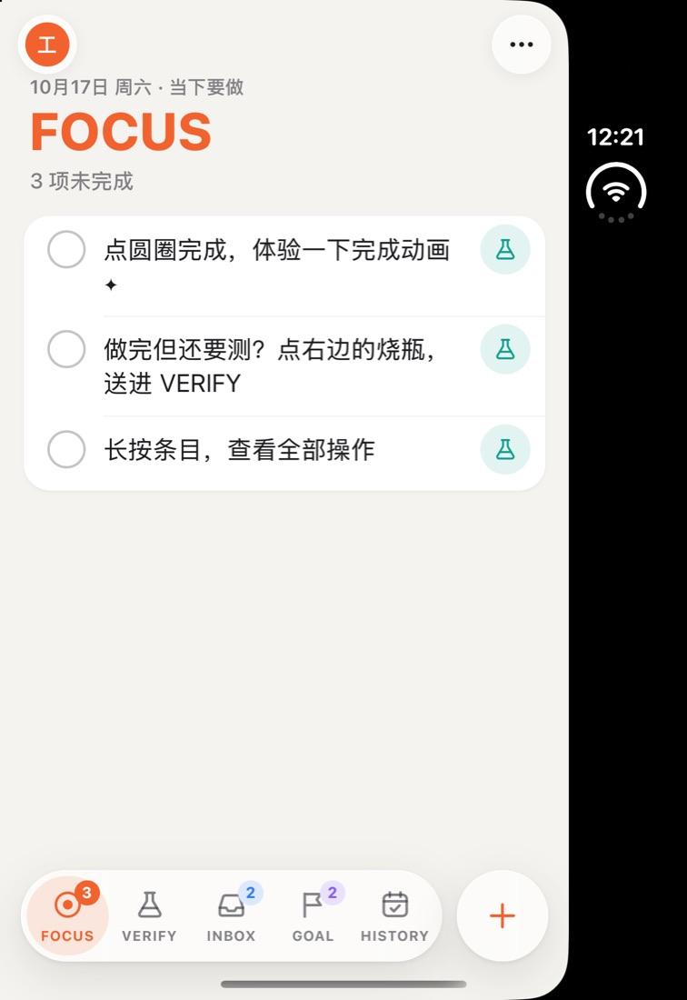
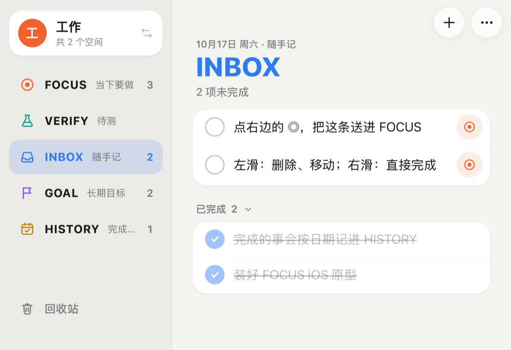
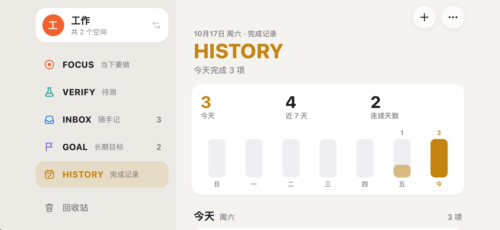

# FOCUS iOS 版（界面原型）

用 Capacitor 8 把一套专为手机重写的 React 界面包成 iOS App。数据逻辑直接复用桌面端的 `src/model.ts` 和 `src/trash.ts`，数据先存在本机，同步以后再接（见 [sync-research.md](sync-research.md)）。

| iPhone Duo 合上（外屏） | iPhone Duo 展开（内屏） | iPhone 17 Pro 深色 |
| --- | --- | --- |
|  |  |  |

## 技术路线

- **Capacitor 8 + React 19 + zustand + motion**，和桌面端同一套技术栈。iOS 工程走 Swift Package Manager，不需要 CocoaPods。
- **复用而不改动**：列表的新建、完成（FOCUS / VERIFY 顶层项完成后进 INBOX）、待测、移动、删除进回收站、恢复、清洗全部调用 `src/model.ts` / `src/trash.ts`；类型来自 `src/types.ts`。移动端只新增文件，不改桌面端代码。
- **为什么不选 SwiftUI**：SwiftUI 要把 `model.ts`（以及将来的同步合并逻辑）移植成 Swift，两套代码长期保持行为一致的成本高；原型阶段 Capacitor 能复用约九成逻辑。将来需要小组件、Siri / 快捷指令时，可以在 Capacitor 工程里加原生扩展，或再评估 SwiftUI。

## 目录

```
src/mobile/                 移动端界面（独立入口，不影响桌面构建）
  index.html / main.tsx     入口
  MobileApp.tsx             布局切换：窄屏标签栏 / 宽屏侧栏
  data.ts                   profile、HISTORY 按天分组、示例数据等纯函数（data.test.ts 有单元测试）
  store.ts                  zustand 状态：多个 profile，各自一份 todos + 回收站
  storage.ts                存储适配层（现在用 Capacitor Preferences）
  native.ts                 触感反馈、键盘高度
  actions.ts                带动画 / 触感的高层操作
  ui.ts                     仅界面用的临时状态
  components/               导航栏、标签栏、侧栏、条目行、滑动行、HISTORY、新建卡片、菜单、面板
  mobile.css                样式（浅色 / 深色、安全区、动态字体）
ios/                        Capacitor 生成的 Xcode 工程（App 图标、启动屏已改成 FOCUS 的）
capacitor.config.json       Capacitor 配置（webDir = dist-ios）
vite.ios.config.mts         移动端的 Vite 配置（端口 5299）
scripts/make-ios-icon.cjs   生成 iOS 图标（满版、无 alpha）
```

## 界面设计

**五个分区**：FOCUS、VERIFY、INBOX、GOAL 四个列表加 HISTORY。每个分区有自己的主题色，大标题、选中态、空状态都跟着变；列表数字显示在标签角标 / 侧栏右侧。

**Profile（界面上叫「空间」）**：例如「工作」「生活」，每个空间有独立的列表和回收站。窄屏点左上角头像、宽屏点侧栏顶部的空间卡片打开面板，可切换、新建、改名、删除（删除需再点一次确认，至少保留一个）。

**新建**：窄屏点标签栏右边的 `+`，宽屏点导航栏的 `+`。底部弹出贴着键盘的输入卡片，可选放进哪个列表；回车添加后保持打开，可以连续输入。拼音等输入法组字时的回车只上屏，不会误提交。

**条目上的操作**（尽量贴近 iOS 习惯）：

| 手势 / 控件 | 作用 |
| --- | --- |
| 点圆圈 | 完成（弹跳 + 粒子 + 划线 + 触感 + 提示音）；FOCUS / VERIFY 顶层项完成后飞向 HISTORY |
| 点文字 | 原地编辑，回车 / 失焦保存 |
| 右滑 | 完成 / 取消完成，滑过一大半直接执行 |
| 左滑 | INBOX：送进 FOCUS；VERIFY：退回 FOCUS；其它：标为待测。另有「移动」「删除」，滑到底直接删除 |
| 长按 | iOS 式上下文菜单：完成、编辑、添加子任务、标为待测 / 退回 FOCUS、移到…（二级菜单）、删除 |
| 右侧圆按钮 | 与桌面一致：INBOX 顶层项 ◎ 送进 FOCUS，FOCUS 顶层项烧瓶标为待测 |
| `1/3 ⌄` 胶囊 | 子任务进度，点按折叠 / 展开 |

子任务无限嵌套，用缩进和层级竖线表示；子项标为待测时留在父项下，勾选圈变成青绿虚线并挂「待测」标签。已完成的顶层项收在「已完成」分组里，可折叠。删除后底部提示条 5 秒内可撤销；右上角 `⋯` 菜单里有回收站（恢复 / 彻底删除 / 清空）、切换空间、完成提示音和触感反馈开关。

**HISTORY**：顶部是今天 / 近 7 天 / 连续天数和 7 天柱状图（点柱子跳到那天），下面按日期分组列出完成的事。父项当天一起完成的子项折叠成「含 N 个子项」；子项单独完成时带上父项路径。点某条可以「标记为未完成」「在某列表中查看」或删除。

**系统适配**：安全区（含 iPhone Duo 的侧边状态栏）、浅色 / 深色实时跟随、动态字体（正文用 `-apple-system-body`，随系统字号缩放）、毛玻璃导航栏和标签栏、触感反馈（Capacitor Haptics）、关闭双击缩放延迟和长按选字。

## iPhone Duo 适配

iPhone Duo 是书本式折叠屏，模拟器里有两块屏：

| 形态 | 屏幕 | 应用可用区域 | 布局 |
| --- | --- | --- | --- |
| 合上，竖握 | 外屏 466×678pt | 约 386×678pt（状态栏是右侧一条竖栏） | 单栏 + 底部标签栏 |
| 合上，横握 | 外屏 678×466pt | 678×466pt | 侧栏 + 列表 |
| 展开，横握（默认） | 内屏 951×669pt | 约 870×669pt（状态栏竖栏在右侧） | 侧栏 + 列表 |
| 展开，竖握 | 内屏 669×951pt | 669×951pt | 侧栏 + 列表 |

- 断点只有一个：**宽度 ≥ 640pt 用双栏**（侧栏放空间卡片、五个分区、回收站），否则单栏底部标签栏。常规 iPhone 横屏、Pro Max 横屏、iPad 也走同一套规则。
- 所有边距都用 `env(safe-area-inset-*)`；侧栏宽度把左侧安全区算进去，横屏时避开灵动岛。
- 宽屏时新建卡片和提示条只占右侧内容栏；空间、回收站面板在宽屏上居中成表单卡片，窄屏上是可下拉关闭的底部面板。

截图：

| 外屏横握（678×466） | 内屏竖握（669×951） | 内屏长按菜单 | 内屏左滑 |
| --- | --- | --- | --- |
|  |  |  |  |

| iPhone 17 Pro 子任务与待测 | 空间面板（深色） | iPhone 17 Pro 横屏 |
| --- | --- | --- |
|  |  |  |

> 外屏横握、内屏竖握两张是在 iPhone Duo 模拟器上用 `devicectl device appResize` 把应用放进同尺寸的可调窗口截的：Xcode 27 的模拟器里这两块屏不响应旋转命令，姿态切换按钮又只能在 Device Hub 里手动点。

## 运行

需要 Node.js 22.12+、Xcode 27（含 iOS 27 模拟器运行时；iPhone Duo 需要 iOS 27.1 运行时）。

```bash
npm install
npm run ios:dev      # 浏览器里调界面：http://localhost:5299（数据存 localStorage）
npm run ios:build    # 类型检查 + 构建 dist-ios + 同步到 ios/ 工程
npm run ios:open     # 用 Xcode 打开工程
npm run ios:run      # 构建并装到选择的模拟器 / 真机上运行
npm run icon:ios     # 重新生成 iOS 图标
```

### 模拟器

1. `npm run ios:build`，然后 `npm run ios:open`，在 Xcode 顶部选模拟器（例如 iPhone Duo、iPhone 17 Pro），点运行。
2. 或者不开 Xcode：`npx cap run ios --list` 看可用设备，`npx cap run ios --no-sync --target <UDID>`。
3. iPhone Duo 的姿态在 Xcode 27 的 **Device Hub** 窗口底部工具栏切换（合上 / 半开 / 全开、旋转）。命令行能做的：`xcrun devicectl device info displays --device <UDID>` 看当前是哪块屏；常规 iPhone 可以用 `xcrun devicectl device orientation set --device <UDID> landscapeLeft` 旋转。
4. 改了网页代码后热更新：先 `npm run ios:dev`，再 `npx cap run ios --live-reload --host <本机局域网 IP> --port 5299`。

### 真机（需要旅行者在 Xcode 里操作）

1. iPhone 用数据线连 Mac，在 iPhone 上「设置 › 隐私与安全性 › 开发者模式」打开开发者模式（会重启）。
2. `npm run ios:build && npm run ios:open`。
3. Xcode 左侧选 **App** 工程 › **TARGETS: App** › **Signing & Capabilities**：勾选 *Automatically manage signing*，**Team** 选自己的 Apple 开发者账号；**Bundle Identifier** 默认是 `app.focus.todo`，如果提示已被占用就改成自己的，例如 `com.<你的名字>.focus`（建议同时改 `capacitor.config.json` 的 `appId`）。
4. 顶部设备选自己的 iPhone，点运行。第一次装好后如果提示「不受信任的开发者」，到 iPhone「设置 › 通用 › VPN 与设备管理」里信任。

## 数据与同步

- 整份数据是一个快照：`{ version, activeProfileId, profiles: [{ id, name, tint, todos, trash }], prefs }`，存在 Capacitor Preferences 的 `focus-mobile-v1` 键里（iOS 上是 UserDefaults）。改动后 0.3 秒合并写入，切到后台时立即落盘。
- 读写只经过 `src/mobile/storage.ts` 的 `SnapshotStorage` 接口（`load` / `save`），以后接同步时换掉实现即可；`profiles[].todos` 与桌面端的 `Todo` 完全同构。
- 首次启动放两个示例空间「工作」「生活」和几条上手提示，删掉即可。
- 和桌面端的数据目前互不相通。

## 已知问题

- **拖拽排序没做**：长按已用于上下文菜单。可考虑在长按菜单里加「排序」模式，或长按后拖动（类似「提醒事项」）。
- **HISTORY 看不出原来在哪个列表**：FOCUS / VERIFY 的顶层项完成后 `list` 会变成 `inbox`，模型里没有记录原列表，所以 HISTORY 只对 GOAL 等列表显示来源。需要的话可以在 `Todo` 上加 `completedFrom`。
- **只在模拟器上验证过**：没有真机；模拟器用的是硬件键盘，软键盘弹出时新建卡片贴键盘的效果靠 `keyboardWillShow` 事件实现，还需要真机确认。
- **iPhone Duo 的两种姿态未在真实姿态下截图**：见上面「iPhone Duo 适配」的说明；合上竖握、展开横握是真实姿态。
- 「半开」姿态（像小笔记本那样立着）没有专门做上下分屏布局，按当前屏幕尺寸走单栏或双栏。
- 桌面端的 profile、HISTORY 还在开发，数据结构定下来后需要对齐（见下）。

## 与桌面端的衔接

- 移动端没有改动桌面端文件；`npm run build`、`npm test` 照常通过（`tsconfig.json` 包含 `src/`，所以桌面端类型检查也会检查 `src/mobile/`）。
- 桌面端的 profile / HISTORY 落地后，建议把「profile 快照结构」和「HISTORY 按天分组」挪到共享的纯逻辑模块里，两端共用；移动端目前的实现在 `src/mobile/data.ts`，可以直接搬过去。
