# FOCUS iOS 版（界面原型）

用 Capacitor 8 把一套专为手机重写的 React 界面包成 iOS App。数据逻辑直接复用桌面端的 `src/model.ts` 和 `src/trash.ts`，数据先存在本机，同步以后再接（见 [sync-research.md](sync-research.md)）。

| iPhone Duo 合上：页签 | iPhone Duo 展开：侧栏 | iPhone 17 Pro 深色 |
| --- | --- | --- |
| 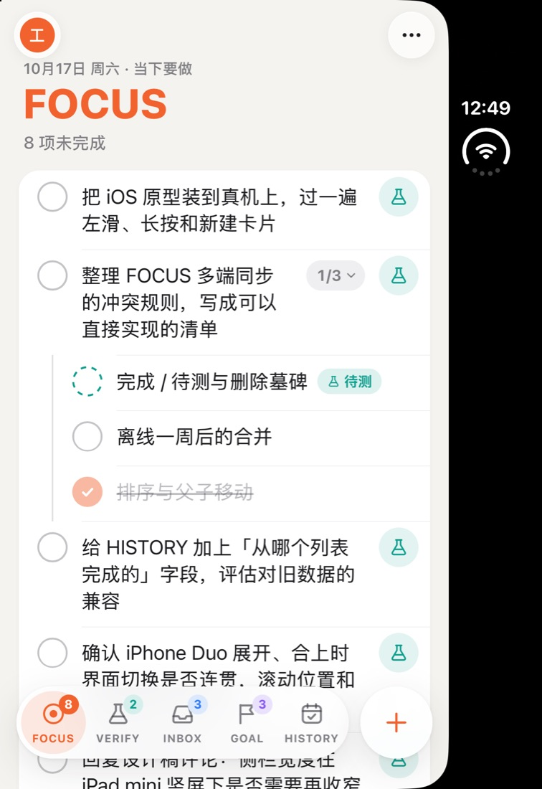 | 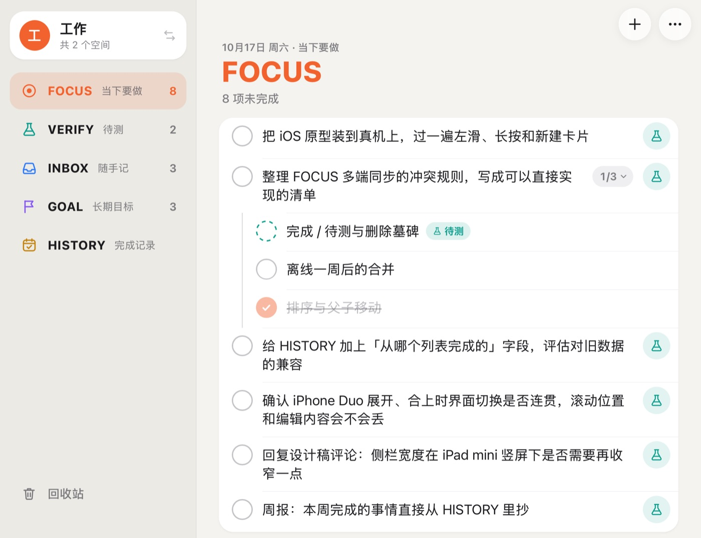 | 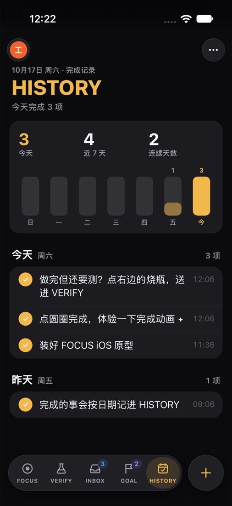 |

## 技术路线

- **Capacitor 8 + React 19 + zustand + motion**，和桌面端同一套技术栈。iOS 工程走 Swift Package Manager，不需要 CocoaPods。
- **复用而不改动**：列表的新建、完成（FOCUS / VERIFY 顶层项完成后进 INBOX）、待测、移动、删除进回收站、恢复、清洗全部调用 `src/model.ts` / `src/trash.ts`；类型来自 `src/types.ts`。移动端只新增文件，不改桌面端代码。
- **为什么不选 SwiftUI**：SwiftUI 要把 `model.ts`（以及将来的同步合并逻辑）移植成 Swift，两套代码长期保持行为一致的成本高；原型阶段 Capacitor 能复用约九成逻辑。将来需要小组件、Siri / 快捷指令时，可以在 Capacitor 工程里加原生扩展，或再评估 SwiftUI。

## 目录

```
src/mobile/                 移动端界面（独立入口，不影响桌面构建）
  index.html / main.tsx     入口
  MobileApp.tsx             布局切换：手机和 Duo 外屏用页签，Duo 内屏 / iPad 用侧栏
  data.ts                   profile、HISTORY 按天分组、示例数据等纯函数（data.test.ts 有单元测试）
  store.ts                  zustand 状态：多个 profile，各自一份 todos + 回收站
  storage.ts                存储适配层（现在用 Capacitor Preferences）
  native.ts                 触感反馈、键盘高度
  actions.ts                带动画 / 触感的高层操作
  ui.ts                     仅界面用的临时状态
  transient.ts              编辑草稿、新建卡片里的字、阅读位置的短时备份（页面万一重载时恢复）
  components/               导航栏、标签栏、侧栏、条目行、滑动行、HISTORY、新建卡片、菜单、面板
  mobile.css                样式（浅色 / 深色、安全区、动态字体）
ios/                        Capacitor 生成的 Xcode 工程（App 图标、启动屏已改成 FOCUS 的）
capacitor.config.json       Capacitor 配置（webDir = dist-ios）
vite.ios.config.mts         移动端的 Vite 配置（端口 5299）
scripts/make-ios-icon.cjs   生成 iOS 图标（满版、无 alpha）
```

## 界面设计

**五个分区**：FOCUS、VERIFY、INBOX、GOAL 四个列表加 HISTORY。每个分区有自己的主题色，大标题、选中态、空状态都跟着变；列表数字显示在页签角标 / 侧栏右侧。

**Profile（界面上叫「空间」）**：例如「工作」「生活」，每个空间有独立的列表和回收站。页签形态点左上角头像、侧栏形态点侧栏顶部的空间卡片打开面板，可切换、新建、改名、删除（删除需再点一次确认，至少保留一个）。

**新建**：页签形态点页签右边的 `+`，侧栏形态点导航栏的 `+`。底部弹出贴着键盘的输入卡片，可选放进哪个列表；回车添加后保持打开，可以连续输入。拼音等输入法组字时的回车只上屏，不会误提交。

**条目上的操作**（尽量贴近 iOS 习惯）：

| 手势 / 控件 | 作用 |
| --- | --- |
| 点圆圈 | 完成（弹跳 + 粒子 + 划线 + 触感 + 提示音）；FOCUS / VERIFY 顶层项完成后飞向 HISTORY |
| 点文字 | 原地编辑，回车 / 失焦保存 |
| 右滑 | 完成 / 取消完成，滑过一大半直接执行 |
| 左滑 | INBOX：送进 FOCUS；VERIFY：退回 FOCUS；其它：标为待测。另有「移动」「删除」，滑到底直接删除 |
| 长按 | iOS 式上下文菜单：完成、编辑、添加子任务、标为待测 / 退回 FOCUS、移到…（二级菜单）、删除 |
| 右侧圆按钮 | 与桌面一致：INBOX 顶层项 ◎ 送进 FOCUS，FOCUS 顶层项烧瓶标为待测 |
| `1/3 ⌄` 胶囊 | 子任务进度，点按折叠 / 展开 |

子任务无限嵌套，用缩进和层级竖线表示；子项标为待测时留在父项下，勾选圈变成青绿虚线并挂「待测」标签。已完成的顶层项收在「已完成」分组里，可折叠。删除后底部提示条 5 秒内可撤销；右上角 `⋯` 菜单里有回收站（恢复 / 彻底删除 / 清空）、切换空间、完成提示音和触感反馈开关。

**HISTORY**：顶部是今天 / 近 7 天 / 连续天数和 7 天柱状图（点柱子跳到那天），下面按日期分组列出完成的事。父项当天一起完成的子项折叠成「含 N 个子项」；子项单独完成时带上父项路径。点某条可以「标记为未完成」「在某列表中查看」或删除。

**系统适配**：安全区（含 iPhone Duo 的侧边状态栏）、浅色 / 深色实时跟随、动态字体（正文用 `-apple-system-body`，随系统字号缩放）、毛玻璃导航栏和页签、触感反馈（Capacitor Haptics）、关闭双击缩放延迟和长按选字。

## 两种导航形态：页签 / 侧栏

规则（按旅行者的要求）：**竖屏和手机一律用页签，iPhone Duo 内屏展开时用侧栏**。

| 设备 / 姿态 | 应用可用区域 | 导航 |
| --- | --- | --- |
| 常规 iPhone 竖屏 | 例如 402×874pt | 底部页签（五个分区 + `+`） |
| 常规 iPhone 横屏 | 例如 874×402pt | 底部页签，变矮：图标和文字并排，大标题收小 |
| Duo 合上，竖握 | 外屏约 386×678pt（状态栏是右侧竖条） | 底部页签 |
| Duo 合上，横握 | 外屏 678×466pt | 底部页签（矮） |
| Duo 展开，横握（默认） | 内屏约 870×669pt | 侧栏 + 列表 |
| Duo 展开，竖握 | 内屏 669×951pt | 侧栏 + 列表 |
| iPad | — | 侧栏 + 列表 |

判断条件是 `(min-width: 640px) and (min-height: 600px)`：手机横过来宽度会超过 640，但高度不到 600，所以仍然是页签；Duo 内屏横竖两个方向的短边都有 669pt，所以总是侧栏。

| 页签：Duo 合上竖握（真实姿态） | 页签：Duo 合上横握 | 侧栏：Duo 展开竖握 |
| --- | --- | --- |
|  | 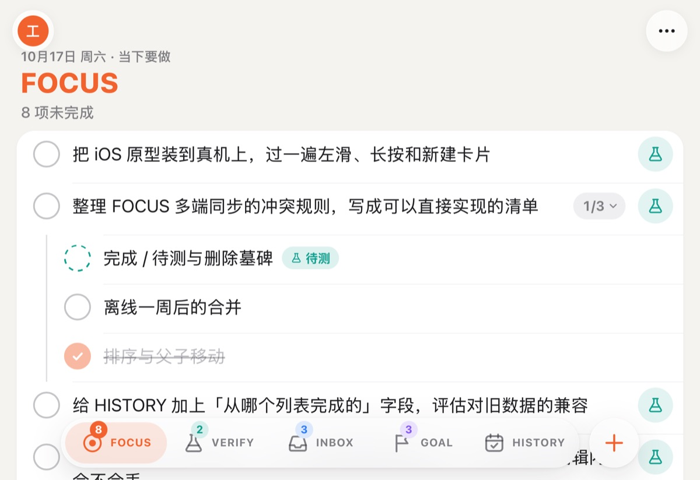 | 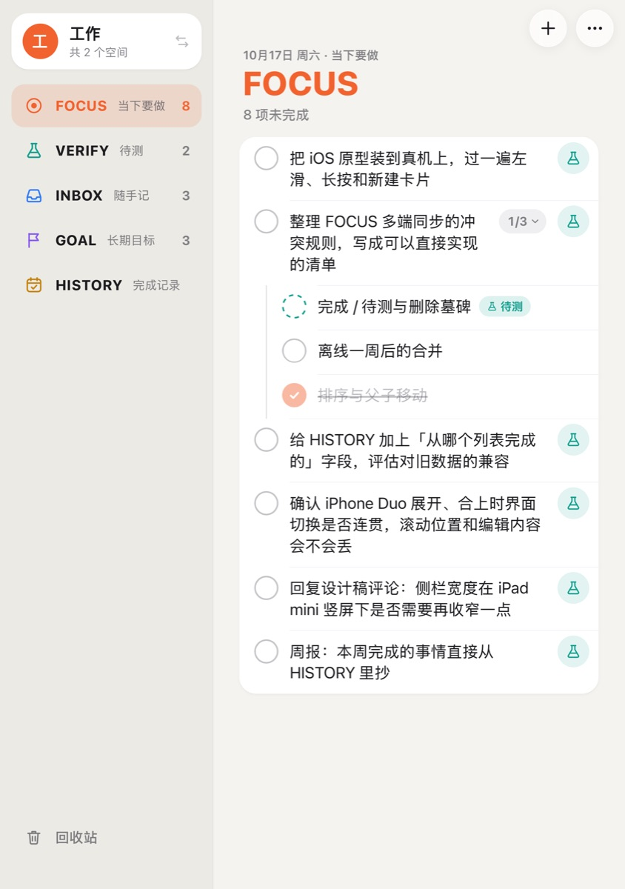 |

| 侧栏：Duo 展开横握 | 页签：iPhone 17 Pro 横屏 |
| --- | --- |
|  | 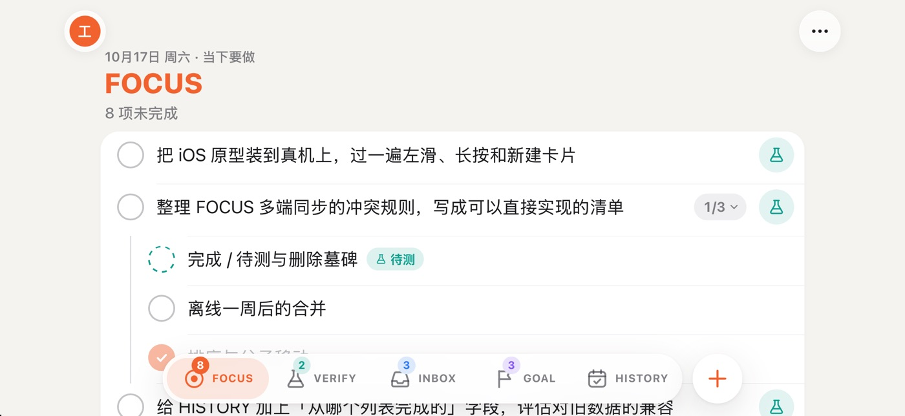 |

### 切换时保留什么、怎么过渡

侧栏和页签**两套导航都常驻在页面里**，切换形态只改 CSS 类，列表组件不卸载、不重建：

- **当前分区、当前空间**：本来就在全局状态里，切换不影响。
- **滚动位置**：侧栏出现 / 消失会让内容栏变宽或变窄，文字重新换行，原来的 `scrollTop` 会对不上。所以滚动时记住导航栏下方第一行（条目、HISTORY 的日期标题等都带 `data-anchor`）和它的偏移；内容栏宽度一变，就把这一行放回原来的位置。浏览器自带的滚动锚定关掉了，免得两边一起修正。
- **正在编辑的标题**：编辑框不卸载，输入的字和光标都在；编辑框随新宽度重新计算高度。新建卡片里没发出去的字也一样保留。
- **按旧位置弹出的东西**：长按菜单、`⋯` 菜单、滑开的行在切换时收起（它们按旧坐标定位，留着会错位）；空间、回收站面板保留，只是在两种形态间换样式（底部面板 / 居中卡片）。
- **万一页面被重载**：编辑草稿、新建卡片里的字、阅读位置每次变动都会短暂存一份（`transient.ts`，两分钟内有效），重新打开时自动恢复。正常折叠 / 展开不会重载，这只是兜底。

过渡动画（约 0.38 秒，iOS 风格的减速曲线）：

- **合上（侧栏 → 页签）**：内容栏一步变宽，侧栏盖在内容上往左滑出去，页签从底部升上来。
- **展开（页签 → 侧栏）**：页签往下沉并淡出，侧栏从左边滑进来，内容栏一步让出位置。
- 内容栏只重排一次，过渡过程中不会被挤成中间宽度。

实测（在 iPhone Duo 模拟器上：先在外屏把 FOCUS 列表往下滚，点开一条进入编辑并输入「1017」，然后切到内屏尺寸、再切回来）：

| 合上状态：滚到中间、正在编辑 | 展开后：同一行仍在顶部，编辑内容和光标都在 |
| --- | --- |
| 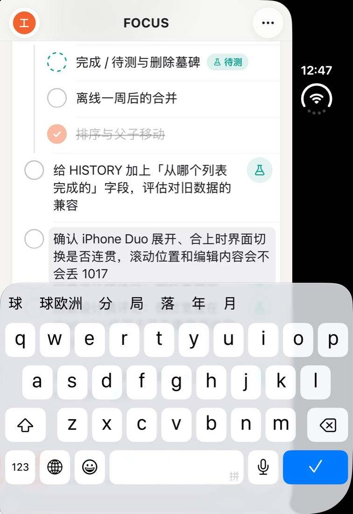 | 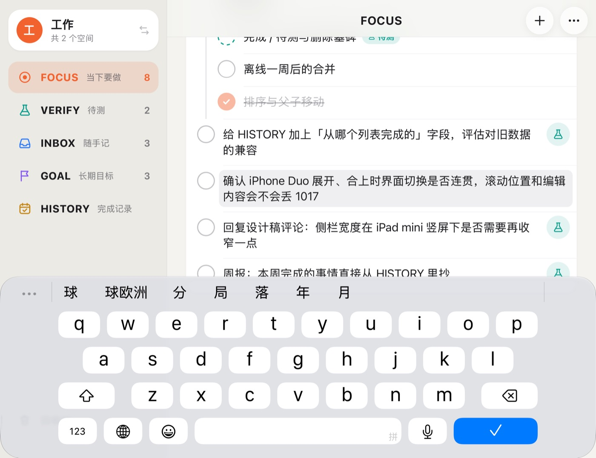 |

合上过程录屏里的三帧：展开时的侧栏 → 窗口已变窄、侧栏正在滑出 → 页签形态（滚动位置、编辑框保持不变）：

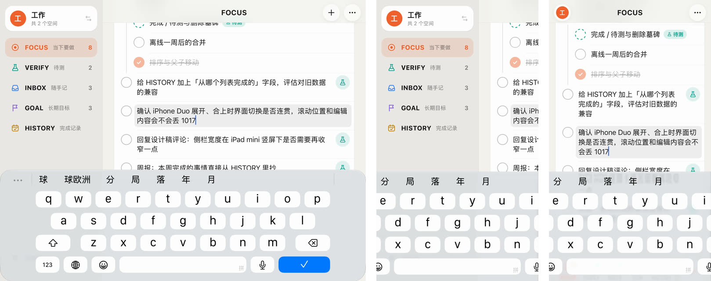

> 关于实测方法：Xcode 27 的模拟器里，Duo 的折叠姿态只能在 Device Hub 窗口底部工具栏手动切换，命令行和自动化都切不了，两块屏也不响应 `devicectl` 的旋转命令。所以除「合上竖握」「展开横握」两张是真实姿态外，其余 Duo 截图和切换录屏都是用 `xcrun devicectl device appResize` 把应用放进同尺寸的可调窗口得到的：应用跑在真实的 iOS WKWebView 里，窗口尺寸和 Duo 的屏一致。展开方向的录屏里，iOS 在窗口变大的瞬间先显示一张拉伸的系统快照，所以没录到侧栏滑入的中间帧。

### 其它适配

- 所有边距都用 `env(safe-area-inset-*)`；侧栏宽度把左侧安全区算进去，横屏时避开灵动岛。
- 侧栏形态下新建卡片和提示条只占右侧内容栏；空间、回收站面板在侧栏形态居中成表单卡片，页签形态是可下拉关闭的底部面板。

更多截图：

| Duo 内屏（真实展开姿态，旧数据） | 内屏长按菜单 | 内屏左滑 |
| --- | --- | --- |
| 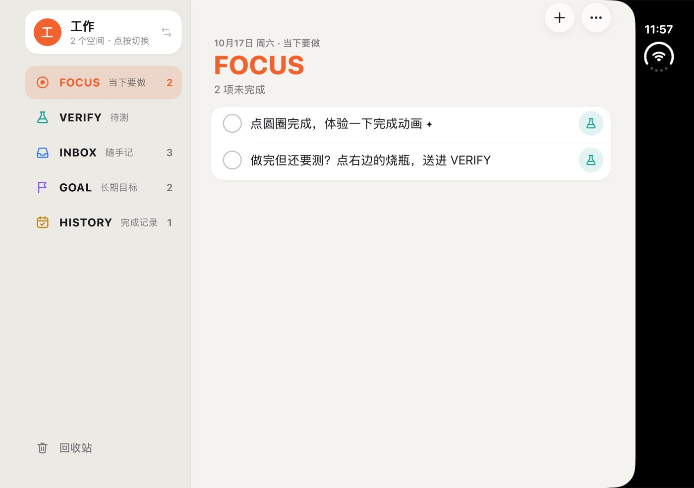 | 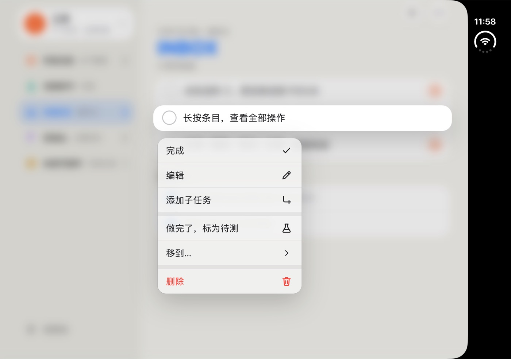 | 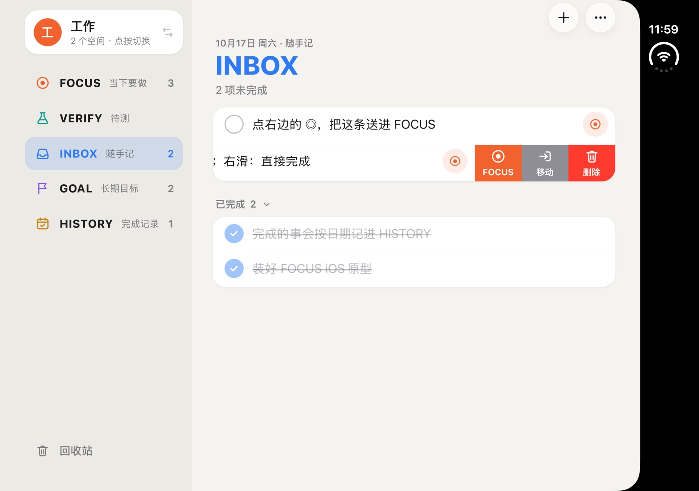 |

| iPhone 17 Pro 子任务与待测 | 空间面板（深色） |
| --- | --- |
| 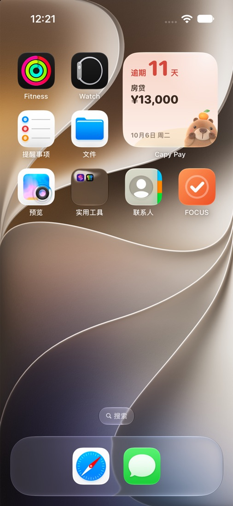 | 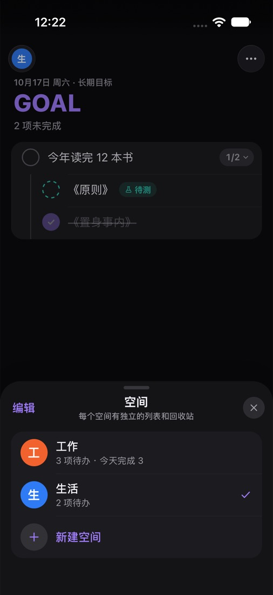 |

## 运行

需要 Node.js 22.12+、Xcode 27（含 iOS 27 模拟器运行时；iPhone Duo 需要 iOS 27.1 运行时）。

```bash
npm install
npm run ios:dev      # 浏览器里调界面：http://localhost:5299（数据存 localStorage）
npm run ios:build    # 类型检查 + 构建 dist-ios + 同步到 ios/ 工程
npm run ios:open     # 用 Xcode 打开工程
npm run ios:run      # 构建并装到选择的模拟器 / 真机上运行
npm run icon:ios     # 重新生成 iOS 图标
```

### 模拟器

1. `npm run ios:build`，然后 `npm run ios:open`，在 Xcode 顶部选模拟器（例如 iPhone Duo、iPhone 17 Pro），点运行。
2. 或者不开 Xcode：`npx cap run ios --list` 看可用设备，`npx cap run ios --no-sync --target <UDID>`。
3. iPhone Duo 的姿态在 Xcode 27 的 **Device Hub** 窗口底部工具栏切换（合上 / 半开 / 全开、旋转）。命令行能做的：`xcrun devicectl device info displays --device <UDID>` 看当前是哪块屏；常规 iPhone 可以用 `xcrun devicectl device orientation set --device <UDID> landscapeLeft` 旋转。
4. 改了网页代码后热更新：先 `npm run ios:dev`，再 `npx cap run ios --live-reload --host <本机局域网 IP> --port 5299`。

### 真机（需要旅行者在 Xcode 里操作）

1. iPhone 用数据线连 Mac，在 iPhone 上「设置 › 隐私与安全性 › 开发者模式」打开开发者模式（会重启）。
2. `npm run ios:build && npm run ios:open`。
3. Xcode 左侧选 **App** 工程 › **TARGETS: App** › **Signing & Capabilities**：勾选 *Automatically manage signing*，**Team** 选自己的 Apple 开发者账号；**Bundle Identifier** 默认是 `app.focus.todo`，如果提示已被占用就改成自己的，例如 `com.<你的名字>.focus`（建议同时改 `capacitor.config.json` 的 `appId`）。
4. 顶部设备选自己的 iPhone，点运行。第一次装好后如果提示「不受信任的开发者」，到 iPhone「设置 › 通用 › VPN 与设备管理」里信任。

## 数据与同步

- 数据和桌面端是同一套可同步文档（`src/sync/`）：列表操作全部走 `src/sync/ops.ts`，与桌面端同一条代码路径。
- 本机存储：文档存在 App 私有目录的 `focus-doc.json`（`@capacitor/filesystem`，先写临时文件再改名）；只属于本机的状态（当前空间、分区、提示音、触感、折叠、同步进度）存 Capacitor Preferences。改动后 0.3 秒合并写入，切到后台时立即落盘。
- 从旧版原型升级时，原来 Preferences 里的整份快照会自动迁移。
- 同步：`⋯` 菜单 →「同步」填坚果云账号和应用密码（存钥匙串），或点导航栏的云朵图标。WebDAV 请求走 `CapacitorHttp`（原生 URLSession）。打开 / 回到前台立即同步，前台每 15 秒轮询，切到后台时申请后台时间把改动传完。冲突发现时自动弹出底部面板。详见 [sync.md](sync.md)。
- 原生插件（钥匙串、后台时间）写在 `ios/App/App/SceneDelegate.swift` 里的 `FocusNativePlugin`，由 `MainViewController` 注册。
- `Info.plist` 只对本机地址放开了明文 HTTP（`NSAllowsLocalNetworking`），给联调用的本机 WebDAV 测试服务器；坚果云走 https。

## 已知问题

- **拖拽排序没做**：长按已用于上下文菜单。可考虑在长按菜单里加「排序」模式，或长按后拖动（类似「提醒事项」）。
- **只在模拟器上验证过**：没有真机；模拟器用的是硬件键盘，软键盘弹出时新建卡片贴键盘的效果靠 `keyboardWillShow` 事件实现，还需要真机确认。
- **真实折叠 / 展开没在模拟器里跑过**：见上面「关于实测方法」。真实设备上应用会从一块屏换到另一块屏，屏幕切换本身是系统动画；如果系统在切换时让输入框失焦，编辑会结束并保存已输入的内容，不会丢，但需要再点一次才能接着编辑。这些都要真机确认。
- 「半开」姿态（像小笔记本那样立着）没有专门做上下分屏布局，按当前屏幕尺寸走页签或侧栏。

## 与桌面端的衔接

- 两端共用 `src/model.ts`、`src/types.ts` 和整个 `src/sync/`；profile 和数据结构已经统一，桌面和手机的数据通过坚果云互通。
- `tsconfig.json` 包含 `src/`，桌面端类型检查也会检查 `src/mobile/`。
- 移动端的 HISTORY 按天分组仍在 `src/mobile/data.ts`，和桌面端的 `src/history.ts` 各有一份，以后可以合并。
